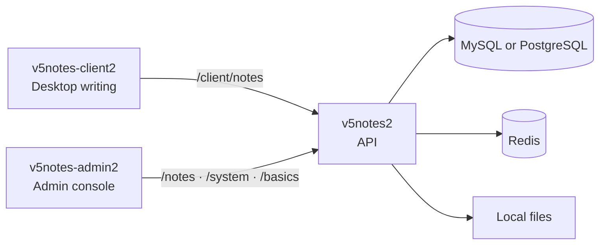

# V5Notes

[简体中文](README.md) · [繁體中文](README.zh-TW.md) · [English](README.en.md)

[](v5notes2/)
[](v5notes2/)
[](v5notes-admin2/)
[](v5notes-client2/)
[](LICENSE)

Keep the ideas. Keep the server.

V5Notes is a Markdown notebook you host yourself. The desktop app is for writing. The admin console is for people and permissions. The API keeps folders, note bodies, revision history, and files in a database you control. Open the app, write, then continue on another computer. The notes stay on your machine.

This document covers three directories: [`v5notes2`](v5notes2/), [`v5notes-admin2`](v5notes-admin2/), and [`v5notes-client2`](v5notes-client2/).

## Contents

- [What it solves](#what-it-solves)
- [How the three apps fit](#how-the-three-apps-fit)
- [What you can do](#what-you-can-do)
- [Stack](#stack)
- [Requirements](#requirements)
- [Run locally](#run-locally)
- [Deploy](#deploy)
- [Extend it](#extend-it)
- [Configuration](#configuration)
- [FAQ](#faq)
- [Before you go public](#before-you-go-public)

## What it solves

Hosted notes are convenient until you want the data back. Local Markdown is free until folders, search, accidental deletes, and a second device get in the way. V5Notes is both: a notebook you can install, back up, and change.

| Situation | What V5Notes does |
| --- | --- |
| Notes are scattered across chats, drives, and local folders | One Markdown document per note, filed in a tree and searchable by title |
| The data should stay on hardware you run | You deploy the API, MySQL or PostgreSQL, Redis, and the upload directory |
| The writing screen is buried under admin tools | The desktop app keeps the tree, the page, and the writing tools. Users, roles, files, and audit logs live in the admin console |
| A page was overwritten, or a whole folder was deleted | Note bodies keep restorable revisions. Deletes go to trash and can be restored for 30 days |
| People in the same household or team read different languages | Simplified Chinese, Traditional Chinese, and English across all three apps |

It fits a person who wants a private notebook, someone opening accounts for family or a small team, and a developer who wants user accounts, permissions, and a note API already in place.

## How the three apps fit



| Directory | Use it for | Built with |
| --- | --- | --- |
| [`v5notes2`](v5notes2/) | Sign-in, notes, folders, trash, revisions, files, and admin APIs | Java 21, Spring Boot 4.1 |
| [`v5notes-admin2`](v5notes-admin2/) | Users and permissions, notes and folders, files, sign-in and operation audit | Vue 3.5, TypeScript, Element Plus, Vite 8 |
| [`v5notes-client2`](v5notes-client2/) | Reading and editing Markdown on Windows, macOS, and Linux | Vue 3.5, TypeScript, Tauri 2 |

The desktop client calls `/client/notes/**`. The admin console calls `/notes/**`, `/system/**`, and `/basics/**`. One note service backs both. Snowflake IDs stay strings from the API response through every page.

## What you can do

**Writing stays out of the way**

- The left sidebar is one tree of folders and notes: search, create, rename, and delete live there.
- Preview and edit share the same editor session, so undo history survives the switch.
- Focus mode hides the sidebar and leaves the page.
- The right side opens an outline or find-in-note.
- Save with `Ctrl/Cmd + S`. Unsaved edits ask before you switch notes or close the window.

**Deletes and edits can come back**

- Notes and folders go to trash for 30 days and can be restored.
- Emptying trash, or purging an item, is what also removes body revisions.
- Each note has a revision list you can preview and restore.

**Accounts and files have a home**

- The admin console covers users, departments, posts, roles, menus, dictionaries, settings, notices, and client registration.
- Online users, sign-in logs, operation logs, and cache monitoring show what the system is doing.
- Files are stored on local disk, so a backup is the database plus the upload directory.
- Sign-in returns an access token and a refresh token. Refresh tokens last 30 days by default and rotate on use. The client never stores the password.

## Stack

| Layer | Choice |
| --- | --- |
| API | Java 21, Spring Boot 4.1.2, MyBatis-Plus 3.5, Sa-Token 1.46, Flyway, Redisson, Hutool |
| Admin | Vue 3.5, TypeScript, Vite 8, Element Plus 2.14, Pinia, UnoCSS, vue-i18n |
| Desktop | Vue 3.5, TypeScript, Vite 6, Tauri 2, the `@v5md` editor, vue-i18n |
| Data | MySQL 8.4 or PostgreSQL, Redis 7.4 |
| Shipping | Docker Compose, an executable jar, Nginx for the admin site |

The API is a Maven multi-module build. The `groupId` is `xin.v5ai`.

| Module | Responsibility |
| --- | --- |
| `note-admin` | Boot entry `xin.v5ai.V5Notes2Application`, sign-in, captcha, tokens |
| `note-modules/note-notes` | Folder tree, notes, search, trash, revisions, client APIs |
| `note-modules/note-system` | Users, roles, menus, dictionaries, departments, OAuth-style clients |
| `note-modules/note-basics` | Local file service |
| `note-common` | Security, cache, data access, encryption |

Flyway migrates the schema when the API starts. Scripts live in `v5notes2/note-admin/src/main/resources/db/migration`, with separate MySQL and PostgreSQL dialects.

## Requirements

| Tool | Version |
| --- | --- |
| JDK | 21 |
| Maven | 3.9 or newer |
| Node.js | 22.12+, 24, or 26 |
| pnpm | 10 or newer, for the admin console |
| npm | For the desktop client |
| Rust | Stable. Required for packaging and `tauri dev` |
| Database | MySQL 8 or PostgreSQL |
| Redis | 7 |

Each app can switch its own UI language. The client sends `Content-Language`, and the API returns messages in that language.

## Run locally

Start MySQL and Redis, then check the connections in `v5notes2/note-admin/src/main/resources/application-dev.yml`. The development database name defaults to `v5notes2-dev`.

```bash
# API, port 8080. The first boot runs Flyway.
cd v5notes2
mvn -DskipTests package
java -jar note-admin/target/v5notes2.jar --spring.profiles.active=dev
```

```bash
# Admin console. Port 80 by default. /dev-api proxies to http://localhost:8080.
# If port 80 needs extra privileges, change VITE_APP_PORT in .env.development.
cd v5notes-admin2
pnpm install
pnpm dev
```

```bash
# Desktop client. The browser dev server is http://127.0.0.1:1420.
cd v5notes-client2
npm install
npm run dev          # UI only
npm run tauri dev    # with the desktop shell
npm test
```

SpringDoc is enabled by default, with groups for the general module, the system module, and notes.

## Deploy

Pick the path that matches the machine you have. Flyway creates the tables on API startup. When Flyway is enabled, do not also apply `v5notes2/script/sql` to the same database.

### 1. Docker Compose

The fastest way to see the whole system, and a solid single-host production setup. Compose starts MySQL 8.4, Redis 7.4, the API, and the admin console. Images copy build artifacts. They do not compile inside the container.

```bash
cd v5notes2
mvn -DskipTests package

cd ../v5notes-admin2
pnpm install
pnpm build

cd ../v5notes2/docker
cp env.example .env    # change the passwords before exposing the host
docker compose up -d --build
```

| Service | Default |
| --- | --- |
| Admin console | http://localhost:8988 |
| API | http://localhost:8080 |
| MySQL | `localhost:3306`, database `v5notes2` |
| Redis | `localhost:6379` |

Back up these three directories:

| Data | Path |
| --- | --- |
| Database | `v5notes2/docker/mysql/data` |
| Redis persistence | `v5notes2/docker/redis/data` |
| Uploads | `v5notes2/docker/uploadfile` |

The MySQL image sets the root password only when the data directory is empty. After the first boot, changing `MYSQL_ROOT_PASSWORD` alone does not rotate the existing password. Keep it aligned with the datasource password in `.env`, or recreate the data directory.

### 2. Jar and Nginx

Use this when MySQL and Redis already exist, or when the admin console should sit behind a domain you already serve.

1. Package the API and start it with the `prod` profile:

```bash
cd v5notes2
mvn -DskipTests package

export V5NOTES_DB_DIALECT=mysql
export V5NOTES_DATASOURCE_MYSQL_URL='jdbc:mysql://127.0.0.1:3306/v5notes2?useUnicode=true&characterEncoding=utf8&serverTimezone=Asia/Shanghai&useSSL=false&allowPublicKeyRetrieval=true&nullCatalogMeansCurrent=true'
export V5NOTES_DATASOURCE_MYSQL_USERNAME=v5notes
export V5NOTES_DATASOURCE_MYSQL_PASSWORD='replace-me'
export V5NOTES_REDIS_HOST=127.0.0.1
export V5NOTES_REDIS_PASSWORD='replace-me'
export V5NOTES_JWT_SECRET='replace-with-a-long-random-string'

java -jar note-admin/target/v5notes2.jar --spring.profiles.active=prod
```

To keep it running under systemd, put those variables in `/etc/v5notes2.env` and use a unit like this:

```ini
[Unit]
Description=V5Notes API
After=network.target

[Service]
WorkingDirectory=/opt/v5notes/v5notes2
EnvironmentFile=/etc/v5notes2.env
ExecStart=/usr/bin/java -Xms512m -Xmx512m -jar /opt/v5notes/v5notes2/note-admin/target/v5notes2.jar --spring.profiles.active=prod
Restart=on-failure
User=v5notes

[Install]
WantedBy=multi-user.target
```

2. Build the admin console and serve `dist/` with Nginx. Production calls the API through `/prod-api`:

```bash
cd v5notes-admin2
pnpm install
pnpm build
```

```nginx
server {
    listen 80;
    server_name notes.example.com;
    root /var/www/v5notes-admin;
    index index.html;

    location / {
        try_files $uri $uri/ /index.html;
    }

    location /prod-api/ {
        proxy_set_header Host $host;
        proxy_set_header X-Real-IP $remote_addr;
        proxy_set_header X-Forwarded-For $proxy_add_x_forwarded_for;
        proxy_pass http://127.0.0.1:8080/;
        client_max_body_size 10000m;
    }
}
```

The trailing slash on `proxy_pass` strips `/prod-api`, so the API still sees paths such as `/auth/login`.

### 3. PostgreSQL

One switch selects both the SQL dialect and the Flyway directory. Create an empty database named `v5notes2`, then start the API:

```bash
export V5NOTES_DB_DIALECT=postgresql
export V5NOTES_DATASOURCE_POSTGRESQL_URL='jdbc:postgresql://127.0.0.1:5432/v5notes2'
export V5NOTES_DATASOURCE_POSTGRESQL_USERNAME=v5notes
export V5NOTES_DATASOURCE_POSTGRESQL_PASSWORD='replace-me'
```

Docker Compose brings MySQL. For an external PostgreSQL server, point the API dialect and URL at that server. Do not load the MySQL scripts into PostgreSQL.

### 4. Desktop installers

After installation, the client only needs the API address. It does not have to run on the API host. Packaging needs a local Rust toolchain:

```bash
cd v5notes-client2
npm install
npm run tauri build
```

Installers land in `v5notes-client2/src-tauri/target/release/bundle/` for the Windows, macOS, and Linux targets Tauri can produce on the current platform. In-app updates read `latest.json` from GitHub Releases.

If the server client id or the sign-in RSA public key differs from the repository defaults, set these before the build:

```bash
export VITE_CLIENT_ID='the client id stored in sys_client'
export VITE_API_PUBLIC_KEY='the public key paired with the server api-decrypt key'
```

### First sign-in

1. Open the admin console. The seeded administrator is `admin` / `admin123`, and the form asks for a captcha. Change that password immediately.
2. Create a user whose type is the client user (`cli_user`). The desktop app accepts only that user type.
3. Open the desktop app, set the server to the API address, for example `http://192.168.1.10:8080`, and sign in with that account.

On the Docker setup the admin console is [http://localhost:8988](http://localhost:8988) and the client server field is `http://localhost:8080`. From another computer, replace `localhost` with the host's LAN or public address.

## Extend it

The three directories move independently. Add a capability in the API, then call it from the admin console, the desktop client, or both.

| Goal | Start here |
| --- | --- |
| Notes, folders, trash, or revisions | `v5notes2/note-modules/note-notes` |
| Sign-in, captcha, access tokens, refresh tokens | `xin.v5ai.web` inside `v5notes2/note-admin` |
| Users, roles, menus, dictionaries | `v5notes2/note-modules/note-system` |
| Uploads and local files | `v5notes2/note-modules/note-basics` |
| Admin pages | `v5notes-admin2/src/views` and `src/api` |
| Writing UI, sidebar, outline, find | `v5notes-client2/src` |
| Copy in three languages | Admin and client i18n, plus API messages |
| Schema | `v5notes2/note-admin/src/main/resources/db/migration` |

A change usually follows this order:

1. Add the endpoint in `note-notes`. Client routes live under `/client/notes`. Admin routes live under `/notes`. Both should call the same service.
2. For a new table or column, add the next Flyway version for MySQL and for PostgreSQL. Do not place the same version in both `common` and a dialect directory.
3. Put admin pages in `src/views` and HTTP calls in `src/api`. Menus come from `sys_menu`. The component path matches the file, such as `notes/notes/index`.
4. Keep client HTTP calls in `src/api.ts`. Pages handle interaction. Folder and note IDs stay strings end to end.
5. Update Simplified Chinese, Traditional Chinese, and English together. The client's `Content-Language` header selects the API message language.

A few writing-experience rules are already settled:

- Preview and edit reuse one editor instance, so the Markdown state and undo history remain.
- Switching to preview saves first. A failed save leaves the note in edit mode.
- Deleting a folder tells the user that child folders and notes go to trash with it.
- Forms and confirmations use the in-app dialogs, with a title, validation, and the server error if the request fails.
- The access token stays in memory. The refresh token may stay on the device. The password never does.

The editor is `@v5md/vue`. Slash commands, block handles, and block sorting belong to that package. The client vendors it under `vendor/v5md`. Update those packages before building if the editor behavior should change.

Admin commands you will use:

```bash
pnpm dev
pnpm build
pnpm lint
```

Module layout, the refresh-token flow, and the full environment list are in [v5notes2/README.md](v5notes2/README.md), [v5notes-admin2/README.md](v5notes-admin2/README.md), and [v5notes-client2/README.md](v5notes-client2/README.md).

## Configuration

Unset variables fall back to the active profile file. Set passwords and secrets explicitly in production.

| Variable | Purpose |
| --- | --- |
| `V5NOTES_SERVER_PORT` | API port, default `8080` |
| `V5NOTES_DB_DIALECT` | `mysql` or `postgresql` |
| `V5NOTES_DATASOURCE_MYSQL_URL` | MySQL JDBC URL |
| `V5NOTES_DATASOURCE_MYSQL_USERNAME` / `PASSWORD` | MySQL account |
| `V5NOTES_DATASOURCE_POSTGRESQL_URL` | PostgreSQL JDBC URL |
| `V5NOTES_DATASOURCE_POSTGRESQL_USERNAME` / `PASSWORD` | PostgreSQL account |
| `V5NOTES_REDIS_HOST` / `PORT` / `PASSWORD` | Redis |
| `V5NOTES_JWT_SECRET` | JWT signing secret |
| `V5NOTES_API_DECRYPT_PUBLIC_KEY` / `PRIVATE_KEY` | API encryption key pair, matched by both front ends |
| `VITE_CLIENT_ID` | Client id, matching `sys_client` on the server |
| `VITE_API_PUBLIC_KEY` | Public key the client uses to encrypt sign-in |

Docker Compose reads `v5notes2/docker/.env`. Names are listed in [env.example](v5notes2/docker/env.example). `MASTER_DATASOURCE_*` is passed through to the datasource inside the container.

<details>
<summary>Mail, SMS, and third-party sign-in</summary>

| Variable | Purpose |
| --- | --- |
| `V5NOTES_MAIL_ENABLED` / `HOST` / `PORT` / `FROM` / `USER` / `PASSWORD` | SMTP |
| `V5NOTES_SMS_ALIBABA_*` | Alibaba Cloud SMS |
| `V5NOTES_SMS_TENCENT_*` | Tencent Cloud SMS |
| `V5NOTES_GITEE_CLIENT_ID` / `CLIENT_SECRET` | Gitee sign-in |

Field encryption can also use `V5NOTES_MYBATIS_ENCRYPTOR_PASSWORD`, `PUBLIC_KEY`, and `PRIVATE_KEY`.

</details>

## FAQ

**The API is up, and the database has no tables.**  
Check that Flyway ran in the API log and that `V5NOTES_DB_DIALECT` matches the server you connected. An existing database is baselined so applied versions are skipped. If note tables are already present and a migration still wants to start at V2, read the baseline notes in [v5notes2/README.md](v5notes2/README.md).

**The admin UI loads, and every request fails.**  
Development uses `/dev-api`. A production build uses `/prod-api`. Nginx has to proxy that prefix to the API and strip it.

**The desktop app cannot sign in.**  
Check, in order: the server URL is reachable from that computer, the account type is the client user, `clientid` matches the server, and the sign-in public key matches `api-decrypt`. The client contacts the server before it submits the password.

**Two people edit the same note.**  
The later save replaces the earlier body. Open that note's revision history to bring a previous body back.

**The database password in Docker changed, and the API still cannot connect.**  
After MySQL has initialized its data directory, `MYSQL_ROOT_PASSWORD` does not rotate the live password. Keep the root password and the datasource password in `.env` identical, or initialize again from an empty data directory.

## Before you go public

- Change the seeded `admin` password. Give MySQL and Redis their own passwords.
- Set `V5NOTES_JWT_SECRET`, generate a new API encryption key pair, and update the admin console and the desktop client to match.
- Keep `docker/.env`, production config, and private keys out of the repository.
- Publish the admin console and the API. Leave MySQL `3306` and Redis `6379` on the private network.
- Back up the database directory and `uploadfile`. Note bodies live in the database. Attachments live on disk.

## Repository

- GitHub: https://github.com/zyw/v5notes
- Gitee: https://gitee.com/zyw/v5notes

The repository root is released under the [Apache License 2.0](LICENSE). The API and the admin console carry their own `LICENSE` files (MIT).
