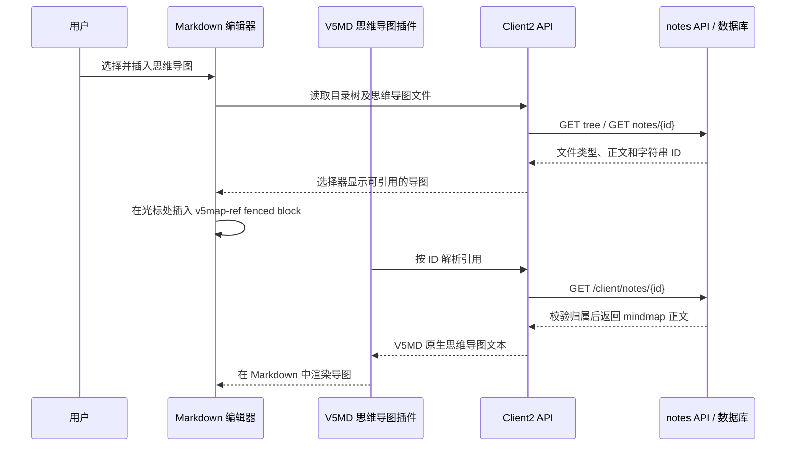

# V5Notes Client2 思维导图文件设计

状态：设计方案（已写入分期选型）  
日期：2026-11-12  
范围：`v5notes-client2` 与其使用的 `v5notes2` 笔记 API。本文只描述设计与实施分期，不包含业务代码改动。

## 目标

在 V5Notes Client2 的“新增文件”入口中，除 Markdown 笔记外，用户可以创建、编辑、保存、重命名和删除思维导图文件。完整产品目标还包括：Markdown 文档可以插入一个思维导图文件的引用，并由当前 V5MD 思维导图插件渲染出图。

思维导图的编辑、解析、布局和绘制都由既有 V5MD 思维导图插件承担。V5Notes 负责工作区文件、服务端读写、目录树、版本历史、回收站、Markdown 引用解析所需的数据加载，以及把插件接到现有工作区流程中。不在 Client2 另造一套画布或思维导图格式。

本文假定“思维导图文件”是服务端同步的工作区文件项，而不是仅保存在用户电脑上的临时文件。地图内容采用 V5MD 插件的原生序列化文本。

## 选型结论与分期（方案 A）

### 已拍板

| 议题 | 结论 |
| --- | --- |
| 存储与 API 形态 | 复用 `note_notes` + 不可变 `content_type`（`markdown` \| `mindmap`）；不新建导图表/API；不用 Mermaid `mindmap` 代码块代替独立文件 |
| 编辑实现归属 | 画布、布局、序列化一律走 V5MD MindMap 插件；Client2 只做工作区接入 |
| **本期交付（方案 A）** | **独立思维导图文件的创建 / 打开 / 预览 / 编辑 / 保存 / 重命名 / 删除，以及树、历史、回收站、会话恢复与旧客户端兼容** |
| **后置（方案 A 之外）** | Markdown `v5map-ref` 插入与引用渲染、引用缓存失效、导出静态导图 —— 作为 Phase 3，不阻塞首期闭环 |
| 旧客户端 / 管理端 | 旧请求缺省只返回 Markdown；本期不加 admin 导图编辑 |

### 前置阻塞

当前 Client2 vendor 仅有 `@v5md/core|view|vue` 0.0.3，**尚无 MindMap 插件包**。Phase 0 未完成前，不得开始依赖插件 API 的前端画布实现；后端 `content_type` 基建可与插件并行。

### 建议实施顺序

```text
Phase 0  V5MD MindMap 插件契约与 vendor 就绪
Phase 1  后端 content_type + 兼容过滤 + 回收站计数
Phase 2  Client2 独立导图文件闭环（方案 A 验收范围）
Phase 3  Markdown v5map-ref 引用与导出静态图（后置）
```

## 已有实现与约束

- Client2 的目录树使用 `GET /client/notes/dir/tree`，当前目录节点 `type=1`、笔记节点 `type=2`。笔记读写统一走 `/client/notes`。API 调用集中在 `v5notes-client2/src/service/api/index.ts`。
- Client2 的笔记草稿由 `Draft` 管理正文、脏状态、保存串行化和服务端 `contentHash`；`useWorkspace.ts` 管理导航保护、版本冲突、选择状态和笔记历史。
- Markdown 编辑器是 `V5Editor`。当前 `EditorPane.vue` 尚未传入思维导图插件。工作区预览和编辑共用已挂载的 V5Editor 实例，切换模式前保存脏正文。
- 当前工作区新建笔记使用名称对话框，目录树行操作集中在 `WorkspaceSidebar.vue` 与 `TreeItem.vue`，对话框集中在 `WorkspaceDialogs.vue`。
- 后端 `note_notes.content` 是 Markdown 正文，`note_revision` 按正文文本记录版本；目录删除和笔记删除经过同一回收站服务。目录树由 `NoteDirectoryServiceImpl` 组装。
- Client2 当前依赖本地 `@v5md/* 0.0.3` 包。`@v5md/view` 的 `V5mdPlugin.blocks` 和 `V5mdBlockRenderer` 支持定制 fenced-code renderer，异步 `hydrate` 可通过 `AbortSignal` 与 `isCurrent()` 避免过期结果写入；这适合作为 Markdown 引用块的接入点。V5Editor 的插件列表在实例创建时读取，因此插件实例必须在编辑器挂载时稳定提供。
- `v5notes-client2/package.json`、锁文件和 `vendor/v5md` 当前有未提交的 0.0.3 包变更。实现时应保留并核对这些工作区改动，不回退或覆盖。

## 设计决策

### 方案比较

| 方案 | 结果 | 决定 |
| --- | --- | --- |
| 只在 Markdown 里写 Mermaid `mindmap` 代码块 | 可以渲染图，但没有独立文件，也不能在多篇文档里引用同一张图 | 不采用 |
| 新建 `note_mindmap` 数据表和一套 API | 类型隔离清楚，但需要重复实现目录、历史、回收站、配额和权限 | 暂不采用 |
| 在现有笔记记录中增加不可变文件类型 | 复用当前笔记的目录、版本、保存冲突、回收站和配额机制；正文格式由类型区分 | **采用** |

### 文件模型

工作区文件是带类型的资源：`markdown` 或 `mindmap`。数据库仍使用 `note_notes` 存放两种文件，增加 `content_type` 区分正文格式。ID、所属用户、目录、名称、更新时间、删除状态和版本保存沿用现有机制。

```text
WorkspaceFile
  id: string
  dirId: string
  name: string
  contentType: 'markdown' | 'mindmap'
  content: string
  contentHash: string
  updateTime?: string
```

Client2 以 `contentType` 分流编辑器，不根据文件名后缀猜类型。`contentType` 创建后不可变；禁止把 Markdown 文件改成思维导图或反向转换。重命名不改类型。

思维导图 `content` 保存 V5MD 插件的规范化序列化文本。V5Notes 不解释节点结构，也不建立另一份 JSON AST。创建空文件时调用插件的空白文档初始化能力；编辑时使用插件的导入/导出能力；保存时把插件序列化的文本原样写回。若插件序列化结果本身是 JSON，它仍作为 `content` 字符串保存。

服务端将思维导图内容按 UTF-8 文本计入现有笔记空间和账户配额。考虑 MySQL `mediumtext` 上限，跨数据库的单文件内容上限按 16,777,215 字节执行；接近上限时客户端在保存前提示，服务端仍进行最终校验。地图文件本身不经图片上传接口。

### Markdown 引用格式

插入命令生成一个独立 fenced block，块体只保存思维导图文件的雪花 ID：

````markdown
```v5map-ref
1234567890123456789
```
````

选择 `v5map-ref` 而不是内联复制思维导图正文，是为了让引用具有稳定身份：重命名、移动目录或修改图内容都不改变 Markdown 引用；一张图可被多篇 Markdown 文档引用。ID 全程使用字符串，不转换成 JavaScript `number`。

这个引用块仍是合法 Markdown。未安装 V5MD 思维导图插件的旧客户端会显示代码块和 ID，不会触发未知 URL 或尝试加载图片。Client2 的 V5MD block plugin 识别 `v5map-ref`，验证块体只有一个非空 ID 后调用工作区解析器读取文件，再调用已有 MindMap plugin 渲染该文件的原生正文。

引用数据流：



思维导图引用是实时引用，不保存正文副本。当前 Client2 中编辑并保存导图后，应使当前会话里的引用缓存失效并重绘。其他设备没有实时推送承诺；重新打开 Markdown 或重新载入后读取最新版本。

### MindMap plugin 接口归属

Client2 使用 V5MD 已有的 MindMap plugin，不重写布局算法、节点绘图或地图交互。V5MD plugin 是思维导图编辑与渲染的唯一实现来源。

Client2 为 API 解析增加薄适配层，向 MindMap plugin 提供：

1. 创建空白思维导图的初始内容。
2. 将已保存内容打开为可编辑画布，并能导出规范化文本。
3. 以只读方式渲染指定内容。
4. 插件卸载或文件切换时释放资源。

如果现有 MindMap plugin 已公开以上能力，Client2 直接接入。若当前公开能力只有 V5MD `V5mdBlockRenderer` 的代码块渲染，则由该 plugin 对外暴露可复用的编辑/渲染适配能力；Client2 不得通过 DOM 拼接、复制另一套 Mermaid 实例或自行生成 SVG 来绕过插件。`v5map-ref` 的读取逻辑可作为一个轻量 reference block renderer，与绘图插件组合安装。

reference block renderer 的生命周期要求：同步 `render()` 只创建占位壳；异步 `hydrate()` 读取按 ID 去重的缓存并渲染；`signal` 被取消或 `isCurrent()` 为 false 时不得更新 DOM；`update()` 仅在引用 ID 或文件哈希改变时重绘；`destroy()` 释放地图实例及监听器。API 返回的对象必须再次确认 `contentType === 'mindmap'`。错误状态只显示通用“思维导图不可用”卡片，不显示其他用户数据或原始服务端响应。

## 后端数据与 API

### 数据库

在 MySQL 和 PostgreSQL 的 `note_notes` 增加：

| 字段 | 类型 | 默认值 | 说明 |
| --- | --- | --- | --- |
| `content_type` | `varchar(16)` | `markdown` | 文件正文类型，仅接受 `markdown`、`mindmap` |

所有现有记录回填或由列默认值保持 `markdown`。已有正文和版本无须转换。新增迁移使用当前迁移序列的下一个可用版本，并同步 `v5notes2/script/sql/notes2.sql` 的全新安装脚本；当前数据库迁移目录最新的数据库专用版本为 V7，common 目录已到 V11，因此须按 Flyway 实际 locations 使用不会冲突的后续版本号。

回收站摘要需区分 Markdown 和思维导图数量。给 `note_trash` 增加 `mindmap_count`，默认 `0`。`note_count` 继续只统计 Markdown 笔记，`mindmap_count` 统计思维导图，`dir_count` 维持目录数量。旧回收站行不回填导图数。单个思维导图进入回收站时 `object_type` 仍为笔记文件类型，响应增加 `contentType: 'mindmap'`；目录批次两类数量分别返回。Client2 回收站文案用“笔记 / 思维导图 / 目录”显示对应数量。

`note_revision` 不需要加类型列：文件类型不可变，当前资源的 `contentType` 可确定每个正文版本如何解码。历史版本正文保存思维导图的规范化文本，与 Markdown 正文一样按 UTF-8 计算哈希和字节数。

### API 契约

复用现有 `/client/notes` 的创建、读取、更新、删除、历史、恢复和回收站 API，不调用 `/basics/base/file` 上传思维导图。

| API | Client2 行为 | 兼容行为 |
| --- | --- | --- |
| `GET /client/notes/dir/tree?includeMindMaps=true` | 目录树包含 Markdown 和思维导图文件 | 缺省仍只返回目录和 Markdown，旧客户端不见新类型 |
| `POST /client/notes` | 创建时传 `contentType` 和插件初始化后的 `content` | 未传 `contentType` 一律按 `markdown` |
| `GET /client/notes/{id}` | 返回 `contentType`、内容、哈希和目录 ID | 旧 Markdown 记录返回 `contentType: markdown` 或保持其旧解析可忽略新增字段 |
| `PUT /client/notes` | 更新正文时带 `id`、`content`、`baseHash` 等现有字段 | 服务器以记录已有类型为准；客户端若提交类型，必须匹配，不允许改类型 |
| list / recent / search | Client2 可请求 `contentType=all`，并按结果类型打开文件 | 参数缺省只查询 Markdown；思维导图搜索首期按文件名匹配，不把插件源文本当 Markdown 内容搜索 |
| delete / trash / restore / purge | 思维导图按同一文件生命周期进入回收站、恢复或彻底删除 | 原 Markdown 删除语义不变 |

后端需在创建、更新、读取、目录树、列表、搜索、回收站摘要和恢复结果中传递 `contentType`。`content_type` 只允许规定的两个值。更新时服务端按 ID 读取现有记录、校验当前用户归属、确认类型未变，再交给现有哈希冲突与版本服务处理。

旧客户端兼容必须在服务端查询层完成：未提供 `includeMindMaps` 或 `contentType` 的旧树、列表、最近文件和搜索请求只返回 Markdown。不能只依赖旧前端忽略未知类型。后台现有 Markdown 管理页面和旧客户端接口默认只操作 Markdown；管理页面不在本期增加思维导图编辑功能。账户总配额统计仍包括两种文件的存储正文。

后端雪花 ID 继续由 Java `Long` 生成，但序列化给前端时作为字符串；请求、路由、树节点、Markdown block 和 localStorage 都保留字符串。

## Client2 工作区与交互

### 新建文件

1. 全局新增入口改为“新建文件”，包含“Markdown 笔记”和“思维导图”。目录行的新增菜单提供同样两个类型。
2. 用户选择类型后打开现有 in-app 名称表单。名称必填、trim 后校验，最多 100 字符；表单提供取消、唯一的主操作、字段或服务端错误。取消或失败时不改变目录树和当前选择。
3. Markdown 创建内容为空。思维导图创建内容来自 MindMap plugin 的空白模板；不在 Client2 写一份独立默认模板。
4. API 创建成功后刷新树、将新项选中并进入该类型的编辑器。API 成功而树刷新失败时，保留已创建项的 ID 和编辑器，并单独显示刷新错误。

### 文件树

- 文件树的目录节点继续使用 `type=1`。文件节点继续使用 `type=2`，新增 `contentType` 字段区分 Markdown 与思维导图，不改变旧客户端对数值 `type` 的含义。
- `TreeItem` 根据 `contentType` 选择文档或思维导图 SVG 图标；两类文件都提供打开、重命名和删除。目录展开、增删改、列表排序和树刷新沿用当前流程。
- 搜索结果和最近文件行也显示文件类型图标，打开动作按 `contentType` 分流。
- 选中状态类型化为 `{ kind: 'markdown' | 'mindmap', id: string }`。新增 localStorage 的最近文件类型和 ID；启动时先检查新键，再把旧的 `v5notes-last-note` 当作 Markdown ID 兼容读取。

### 编辑与预览

工作区的文件数据使用 `WorkspaceFile` 判别联合。Markdown 文件继续由当前 `V5Editor` 渲染，传入 MindMap plugin 与引用解析器。地图文件使用 MindMap plugin 的专用编辑画布与只读视图，不把地图源文本误交给 Markdown 工具栏处理。

地图文件和 Markdown 文件都遵循工作区的保存语义：

- 显示明确的预览 / 编辑状态和显式编辑入口。
- 修改后标记 dirty；保存、预览切换、文件导航、删除、会话过期或关闭窗口按现有脏草稿守卫执行。
- 保存成功后更新 `contentHash`、更新时间和目录树；失败时留在编辑态并保留内存草稿。
- 保存冲突使用当前冲突处理 UI；强制覆盖前先让用户选择，并保留服务端当前版本。
- 图内撤销/重做由 MindMap plugin 管理；保存后的历史由现有服务端 `note_revision` 管理。历史列表预览和恢复时按当前文件类型调用相同 MindMap plugin。
- Markdown 的预览 / 编辑继续复用已挂载的 V5Editor，不因模式切换销毁编辑器实例或丢失撤销历史。切换到另一个工作区文件时仍先通过现有 guard 保存或解决草稿。

### Markdown 插入与引用

1. V5MD 工具栏或 slash menu 提供“插入思维导图”命令；命令打开 Client2 文件选择器，只显示当前用户可读的思维导图，可按目录浏览和按名称搜索。
2. 确认选择后，插件命令通过 V5MD 的受控 `insertText` / `replaceSelection` 在光标处插入 `v5map-ref` block，不直接改 DOM。插入后 Markdown 草稿变脏，按普通正文保存。
3. block 在 WYSIWYG / 预览中显示为响应式导图卡片，卡片上有打开原文件入口；在 Markdown 源码模式下保留 fenced block 文本。编辑引用只允许替换或删除引用，不允许在卡片内意外更改原地图。
4. 多处引用同一 ID 时按文件 ID 去重加载。缓存按 `id + contentHash` 识别版本，当前客户端保存该地图后立即清除相关缓存并刷新当前文档。
5. 移动、重命名不影响引用。移入回收站后显示“思维导图不可用”；恢复后同 ID 自动重新解析。彻底删除后引用保留为不可用卡片，不自动删改其他 Markdown 正文。
6. 跨账户、已删除或不存在的 ID 都显示统一不可用状态；服务端必须按当前登录用户校验归属。Markdown 中的 ID 不是公开访问凭证。

原始 Markdown 导出保留引用 block。使用应用内渲染 HTML、图片或 PDF 导出时，插件提供静态图像渲染，避免导出物依赖本地插件运行环境。思维导图文件的通用 `.xmind` 导入导出、Markdown 与导图文件的 ZIP 打包、外链公开访问不属于首期范围。

## 生命周期和一致性

### 保存、版本和冲突

MindMap plugin 序列化后仍通过现有 `PUT /client/notes` 保存。哈希针对完整的插件原生序列化字符串计算。地图结构本身不另做客户端版本服务，也不把每次节点拖动逐个写成服务端版本。插件内部撤销历史与服务端已保存快照职责分开。

内容类型不可变，因此版本历史行只需保存正文，不需新增 `content_type` 列。恢复历史版本时先按当前文件类型解码；如果历史正文无法被当前插件解析，保留文件和历史不变，显示版本不可恢复错误，不以空地图覆盖。

### 回收站和目录删除

思维导图仍属于 `note_notes` 文件，因此使用现有 `DELETE /client/notes/{id}` 和目录删除 API。目录删除递归收纳子目录下的 Markdown 与思维导图；回收站记录分别返回两类文件数。当前选中的地图在删除成功后清空，并清理相应的最近文件选择。

恢复地图后按回收站返回的 ID 和类型重新打开；恢复位置不可用时按现有规则放回根目录。地图引用不做级联删除，因为同一张地图可能被多篇笔记共享。

### 未授权和异步竞态

- MindMap renderer 不把完整地图正文放进引用 marker，读数据统一走已登录 API。
- 文件类型、用户归属和 ID 都由服务端复核；Client2 的 picker 只减少误操作，不代替鉴权。
- 插件在地图快速切换、Markdown 内容更新、编辑器卸载或会话过期时取消未完成读取。过期请求不得把旧地图写进新 block。
- 401 仍走现有会话失效处理；未保存地图草稿按现有 reauthenticate 流程留在内存中，不清空。
- 限制 map source 大小、节点数和嵌套深度应由插件定义并在保存前给出可理解的错误；后端至少校验类型和正文最大字节数，不能仅信任客户端。

## 分阶段实现清单（方案 A）

本文不改业务代码；下列清单用于后续实施拆分。**方案 A 以 Phase 0–2 为首期交付；Phase 3 后置。**

### Phase 0 — 插件与契约（前置阻塞）

- [ ] 确认 V5MD MindMap plugin 正式包名与公开导入路径（禁止引用 `dist` 私有文件）
- [ ] 确认空白模板、导入/导出、只读渲染、资源释放的公开方法名与行为
- [ ] 约定序列化格式、默认主题，以及大小 / 节点数 / 嵌套深度上限的报错语义
- [ ] 将插件包加入 `vendor/v5md` 并更新依赖；**保留并核对**现有未提交的 `@v5md/* 0.0.3` 变更，不回退覆盖
- [ ] 用最小 demo 验证：空白创建 → 编辑 → 导出文本 → 再导入一致

### Phase 1 — 后端类型基建

- [ ] Flyway（MySQL + PostgreSQL）增加 `note_notes.content_type`（默认 `markdown`）与 `note_trash.mindmap_count`（默认 `0`）；同步 `script/sql/notes2.sql`
- [ ] 迁移版本号避开 common（已到 V11）与库专用（已到 V7）撞号
- [ ] 实体 / BO / VO / `NotesConvert` 透传 `contentType`；创建未传则 `markdown`；更新禁止改类型
- [ ] `GET /client/notes/dir/tree?includeMindMaps=true`；缺省树/列表/最近/搜索仍只返回 Markdown
- [ ] `POST/GET/PUT /client/notes` 读写带类型；list/recent/search 支持 `contentType=all`；导图搜索首期只按文件名
- [ ] 回收站单项返回 `contentType`；目录批次分计 `note_count` / `mindmap_count`
- [ ] 配额与内容字节上限对两种类型生效；管理端查询继续默认只操作 Markdown
- [ ] 集成测试：旧请求过滤、默认值、类型不可变、归属、contentHash、回收站计数

### Phase 2 — Client2 独立导图文件闭环（方案 A 验收）

- [ ] `src/service/api/index.ts`：`Note` / `TreeNode` 加 `contentType`；树带 `includeMindMaps`；创建/列表/搜索类型化（**首期可不做引用专用读取 helper**）
- [ ] `draft.ts` / `useWorkspace.ts` / `workspaceContext.ts`：类型化选择与草稿；脏守卫、冲突、401、历史/删除/恢复复用现流
- [ ] `WorkspaceSidebar` / `TreeItem` / `TreeIcon` / `WorkspaceDialogs`：「新建文件」→ Markdown / 思维导图；名称对话框规范不变；导图图标
- [ ] `EditorPane`（或独立视图）：`contentType` 分流；Markdown 仍用现有 V5Editor（预览↔编辑复用实例）；导图用插件画布 / 只读预览
- [ ] 创建：MD `content: ''`；导图用插件空白模板；成功后刷新树、选中、进入编辑；树刷新失败单独报错且保留已打开文件
- [ ] 会话恢复：新键存 `{ id, contentType }`；旧 `v5notes-last-note` 兼容为 markdown
- [ ] `NoteHistoryDialog` / 回收站 UI：按类型预览与恢复；文案区分笔记 / 思维导图 / 目录
- [ ] i18n（zh-CN / zh-TW / en）与样式：类型名、表单、状态、插件错误；图标与专注/窄屏布局
- [ ] 手工/自动化验收：见下方「方案 A 首期验收」

### Phase 3 — Markdown 引用与导出（后置，不阻塞方案 A）

- [ ] `api`：MindMap 引用读取（确认 `contentType === 'mindmap'`）与去重缓存（`id + contentHash`）
- [ ] Markdown 工具栏 / slash「插入思维导图」→ 文件选择器 → 插入 `v5map-ref` fenced block
- [ ] V5Editor 挂载 MindMap + `v5map-ref` block plugin；hydrate 遵守 AbortSignal / `isCurrent()`
- [ ] 本会话保存导图后失效引用缓存并重绘；删除/无权限显示统一不可用卡片
- [ ] 导出：MD 保留 marker；HTML / 图片 / PDF 由插件生成静态图
- [ ] 相关 i18n 与嵌入卡片样式

### 需要修改的实现区域（按阶段对照）

#### Client2

| 区域 | Phase 2 | Phase 3 |
| --- | --- | --- |
| `src/service/api/index.ts` | 类型、树、CRUD | 引用读取 / 缓存辅助 |
| `draft` / `useWorkspace` / `workspaceContext` | 类型化工作区文件 | 保存导图后通知引用失效 |
| `WorkspaceSidebar` / `TreeItem` / `TreeIcon` / `WorkspaceDialogs` | 新建双类型、图标 | 插入导图用的选择器可复用树数据 |
| `EditorPane` 或独立地图视图 | 按类型挂编辑器 | Markdown `plugins` 挂引用渲染 |
| `NoteHistoryDialog` / 回收站 | 按类型预览与计数 | — |
| i18n / styles | 类型与导图编辑文案 | 引用不可用与嵌入卡片 |

#### 后端 `v5notes2`（主要为 Phase 1）

- `NoteNotes`、`NoteNotesBo`、`NoteNotesVo`、`NotesContentVo`、`NotesTreeVo`：传递 `content_type`，旧请求缺省 Markdown
- `ClientNotesController`、`ClientNotesDirController`、`NoteNotesServiceImpl`、`NoteDirectoryServiceImpl`、`NotesConvert`：类型筛选、树包含导图、创建/更新校验、搜索与树映射
- `note_revision`：继续现有实现；哈希对插件源文本生效
- `NoteTrashServiceImpl`、回收站 VO / Mapper / SQL：单项类型 + `mindmap_count`
- MySQL、PostgreSQL Flyway 与 `script/sql/notes2.sql`
- 后台笔记查询继续默认只操作 Markdown

## 验收标准

### 方案 A 首期验收（Phase 0–2 必须满足）

1. 新增文件菜单能创建 Markdown 和思维导图；名称验证、失败留窗、取消不变、成功刷新和自动选中符合现有 CRUD 对话框规范。
2. 思维导图文件可以通过 V5MD plugin 创建、打开、编辑、保存、预览、撤销重做、重命名和重新打开；WebView 刷新后按类型和 ID 恢复。
3. 目录递归删除、恢复和清空回收站能正确处理两种文件；回收站分别显示 Markdown、思维导图和目录数量。
4. 文件 ID 在 tree、localStorage、请求和 Vue 状态中始终是字符串，覆盖超过 JavaScript 安全整数范围的雪花 ID。
5. 旧客户端不传新参数时仍只收到 Markdown；旧 Markdown 内容和 CRUD 不改变。
6. Client2 的地图保存失败、冲突、401、异步切换文件、超大 source 都保留可恢复草稿或明确错误，不把空内容写回；Markdown 既有保存/预览行为不回归。

### 完整目标验收（含 Phase 3；后置）

7. Markdown 的“插入思维导图”可选中现有地图并在当前光标位置插入唯一 ID 引用；预览显示相同地图，源模式显示 marker，重命名或移动地图不破坏引用。
8. 保存地图后，所有当前文档中指向该 ID 的块刷新为最新 contentHash；同一地图重复引用只产生一次文件读取。
9. 删除地图后引用显示不可用；从回收站恢复后引用恢复。永久删除后不级联修改 Markdown 正文。
10. 旧客户端打开带引用 marker 的 Markdown 时能看到可读的代码块，不会错误请求或丢失原文。
11. Markdown 导出保留原始引用块；HTML、图片和 PDF 导出由 MindMap plugin 生成静态导图。
12. 引用相关失败路径（无权限、失效 ID、异步过期请求）显示统一不可用状态，不泄露其他用户数据。

## 验证清单

### 方案 A（Phase 0–2）

- 前端模型/API：缺省类型解析、两类创建/读取、contentType 不可变、ID 字符串、树与搜索类型映射。
- 后端集成：两种数据库迁移、旧记录默认值、旧请求默认过滤、类型校验、用户归属、内容哈希、大小限制、版本和回收站计数。
- 编辑交互：新建取消/失败/成功、地图脏草稿离开、保存失败留态、地图恢复历史、窗口关闭和重新认证。
- 回归：现有 Markdown 的预览/编辑复用、目录 CRUD、旧客户端默认 API、历史版本、搜索、最近文件、回收站和配额。

### Phase 3 追加

- 引用渲染：单块、多块、重复 ID、空/格式错误 marker、地图重命名、移动、内容更新、回收站删除/恢复/清空、无权限、网络失败、异步过期请求、深色模式和窄窗口。
- 导出：含导图的 Markdown 原文、HTML、PNG 与 PDF；确认静态导出不依赖远程地图请求完成后的编辑器 DOM 状态。

## 非目标

- 修改 `v5notes-client/` 旧客户端 UI 或替换其 Markdown 编辑器。
- 在 Client2 自研思维导图解析器、画布、布局、SVG renderer 或另一种节点数据格式。
- 用户协作实时编辑、离线冲突合并、地图权限共享、地图公开 URL。
- `.xmind` 等第三方文件导入导出、地图附件版本管理、地图引用自动级联删除。
- `v5notes-admin2` 管理端地图编辑与地图统计面板。
- **方案 A 首期不交付** Markdown `v5map-ref` 插入/渲染与导图静态导出（设计保留，归 Phase 3；不等于取消）。

## 由实施者决定

- 现有 V5MD MindMap plugin 的正式包名和公开导入路径；只能依赖包公开导出，不能引用其 `dist` 私有文件。（Phase 0）
- plugin 当前编辑器/序列化 API 对应的具体方法名，以及空白地图默认主题；接口需要满足本文“MindMap plugin 接口归属”中的行为。（Phase 0）
- 新 migration 的实际编号须结合 Flyway 配置的全部 locations 再确认，避免与 common migration 撞号。（Phase 1）
- `v5map-ref` reference renderer 的 UI 细节可在不改变块语法、实时引用和错误行为的前提下调整。（Phase 3）
- Phase 2 中地图主界面是扩 `EditorPane` 还是独立组件，只要预览/编辑/脏草稿语义与本文一致即可。

