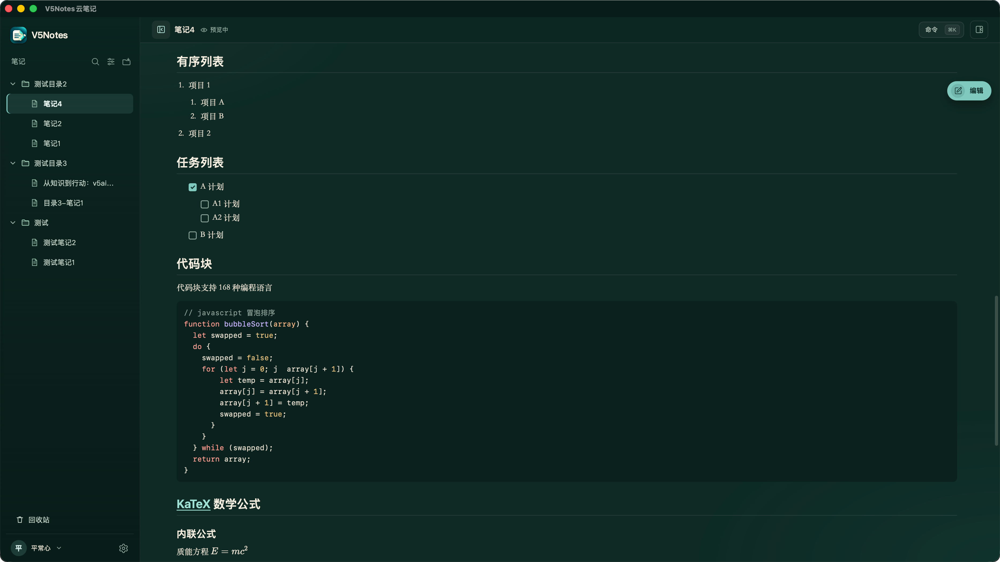
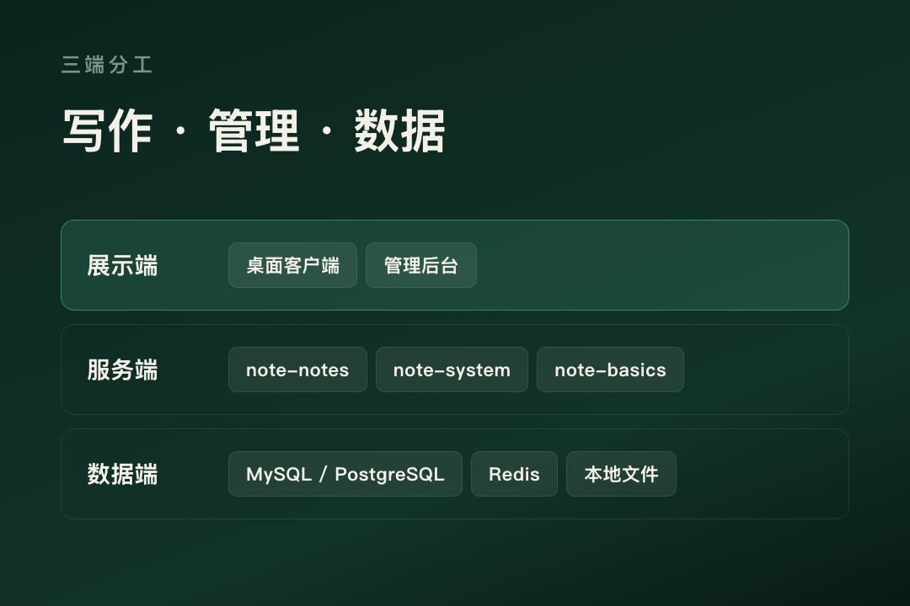
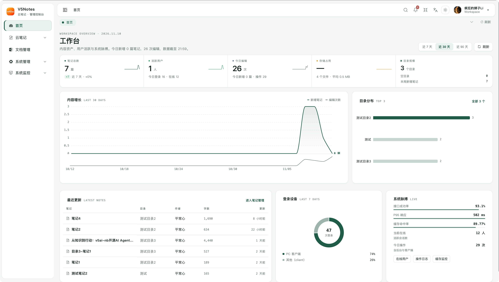

# 云笔记很好用，直到你想把数据拿回来

> 摘要：可私有部署的 Markdown 云笔记：桌面写作、后台管人，数据存在自己的数据库里，开源免费。

云笔记确实好用，直到某天你想把写了三五年的内容整包搬走。

导出缺斤少两、附件散落、想自建又得从零写一套用户和权限——很多人卡在这个念头，最后继续将就。

V5Notes 把这两件事接上了：一套你能自己装、自己备份、自己改的 Markdown 云笔记。

## 一、先说结论：一套能自己装、自己备份的 Markdown 云笔记

V5Notes 是 Apache 2.0 / MIT 双协议的开源项目，三端分离：桌面客户端负责写作，管理后台负责人和权限，后端把目录、正文、历史版本和文件收在你自己的数据库里。

没有租约、没有按座席计费，也没有「数据概不迁出」的小字。服务器在哪、备份给谁，你说了算。

## 二、三端怎么配合

客户端走 /client/notes，后台走 /notes、/system、/basics，同一套笔记服务同时服务两端，雪花 ID 从接口到页面全程按字符串处理。

部署上，一个 docker compose up 就能把 API、管理后台、MySQL、Redis 一起拉起来；也可以打成 Jar 配 Nginx，数据库换成 PostgreSQL。

## 三、写作与管理，各归其位

写作界面只留目录、正文和写作工具：目录笔记混排的树、编辑/预览/源码三态、大纲、查找、命令面板，Ctrl/Cmd+S 保存，切走前会先问你。

管理后台则把用户、部门、岗位、角色、菜单、字典、参数、通知打包，还带在线用户、登录日志、操作日志和缓存监控。

> 把「数据在别人那儿」换成「数据在我这儿」，安全感是不一样的。

## 四、边界：它不是万能钥匙

需要说清楚：V5Notes 是单机优先的私有部署方案，不做多人实时协同；同一篇笔记两人同时改，后保存的会覆盖先保存的，需要靠历史版本找回。

它也不带 SaaS 级的运维兜底——备份、证书、升级都得你自己来。它适合愿意为一台服务器负责的个人和小团队。

| 能力 | 说明 |
| --- | --- |
| 数据自主 | 数据库与文件都在你的机器 |
| 三端三语 | 客户端 · 后台 · 简繁英 |
| 版本与回收站 | 历史版本 + 30 天回收站 |
| 部署灵活 | Docker / Jar+Nginx / MySQL·PostgreSQL |

一句话：如果你在意「笔记到底存在谁家」，V5Notes 值得放进你的服务器。

---

**官网：**https://v5notes-website.v5ai.xin/
**项目地址：**https://github.com/zyw/v5notes
**Gitee：**https://gitee.com/zyw/v5notes
**开源协议：**Apache 2.0 / MIT

> 官网：v5notes-website.v5ai.xin ｜ 源码：github.com/zyw/v5notes ｜ 关注「自托管笔记」回复「部署」领取部署清单