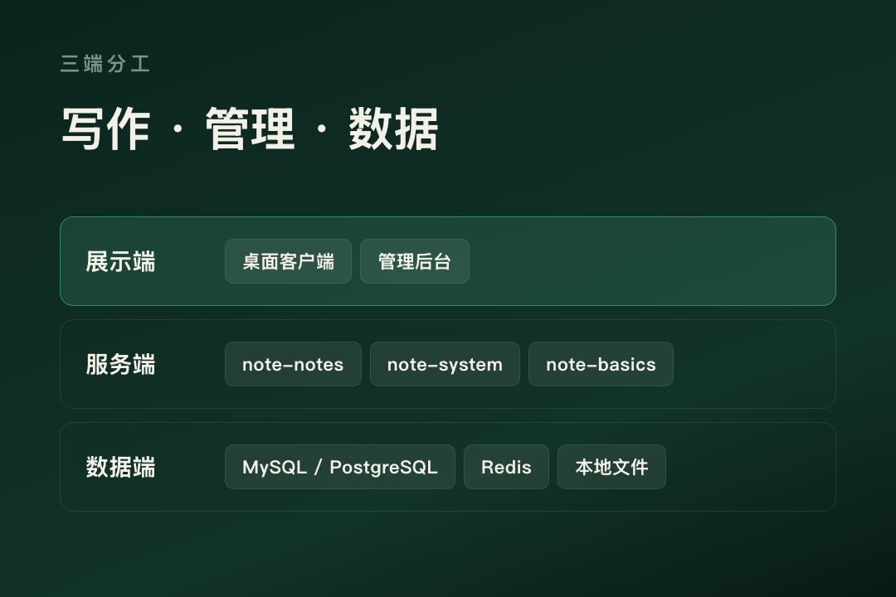
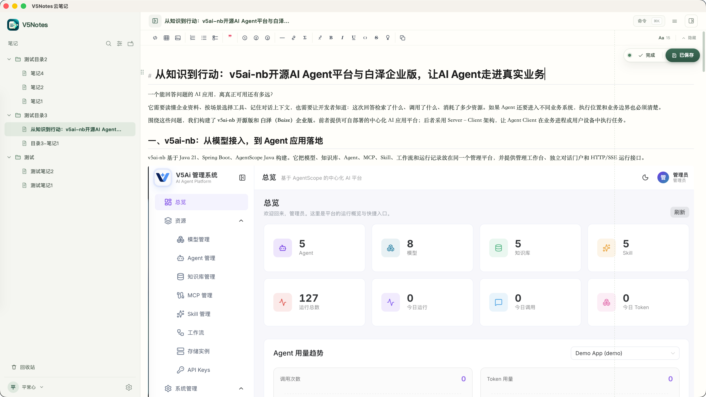

# 把笔记数据拿回来之后，我又给它加上了实时消息

> 摘要：可私有部署的 Markdown 云笔记：桌面写作、后台管人，数据在自己库里；2.0.1 起支持实时消息。

云笔记确实好用，直到某天你想把写了三五年的内容整包搬走。

导出缺斤少两、附件散落、想自建又得从零写一套用户和权限——很多人卡在这个念头，最后继续将就。

V5Notes 想接住的正是这件事：一套你能自己装、自己备份、自己改的 Markdown 云笔记。

2.0.1 刚发布，还补上了实时消息——自托管，也能收到提醒。

## 一、先说结论：一套能自己装、自己备份的 Markdown 云笔记

V5Notes 是 Apache 2.0 / MIT 双协议的开源项目，三端分离：桌面客户端负责写作，管理后台负责人和权限，后端把目录、正文、历史版本和文件收在你自己的数据库里。

数据落在你自己的 MySQL 8 或 PostgreSQL，缓存走你的 Redis，附件存在本地文件目录；没有租约、没有按座席计费，也没有「数据概不迁出」的小字。服务器在哪、备份给谁，你说了算。

## 二、三端怎么配合

客户端走 /client/notes，管理端走 /notes、/system、/basics，两边复用同一套笔记服务；雪花 ID 从接口到页面全程按字符串处理，不会在 JS 里被精度截断。

部署也简单：一个 docker compose up，把 API、管理后台、MySQL、Redis 一起拉起来；也可以打成 Jar 配 Nginx，数据库换成 PostgreSQL。方言由 V5NOTES_DB_DIALECT 一个开关切换，建表交给 Flyway。

## 三、写作体验：从目录到三态编辑

编辑器基于自家的 @v5md：目录和笔记混在一棵树里，搜索、新建、重命名、删除都在一处；编辑、预览、源码三态随时切换，撤销记录留在同一次会话里。

正文支持表格、任务列表、KaTeX 公式和 168 种语言的代码高亮；右侧能拉出大纲、做全文查找，命令面板把常用操作收进一个入口，专注模式收起侧栏只剩正文。Ctrl/Cmd+S 保存，切走前会先问你要保存、放弃还是取消。

## 四、2.0.1 更新了什么：实时消息与更安全的令牌

2.0.1 把「自托管」和「及时」这两件事接上了：管理端和桌面客户端都支持实时消息与通知，侧栏多了消息铃铛。WebSocket 连接用一次性票据换取，不把 JWT 塞进 URL；消息盒子的富文本按白名单消毒后再渲染，公告不会再显示成一堆裸标签。

安全上延续一套克制的做法：登录用 RSA 加密，访问令牌只放在内存，刷新令牌默认 30 天、一次性轮换，过期自动续期、失败才让你重新登录；客户端从不保存你的密码。它还补了桌面单实例——重复启动会把 Deep Link 交给已运行的窗口，不再打断社交登录的回调。

> 自托管不是把门焊死，而是把钥匙握在自己手里。

## 五、边界与适用性

需要说清楚边界：V5Notes 单机优先，不做多人实时协同；同一篇笔记两人同时改，后保存的会覆盖先保存的，要靠历史版本找回。

它也不提供 SaaS 级的运维兜底，备份、证书、升级都得自己来。反过来，你换来的是一套干净、可改、可迁移的代码：Java 21 + Spring Boot 4.1 的后端，Vue 3.5 + Tauri 2 的客户端，Vue 3.5 + Element Plus 的管理后台。

| 能力 | 说明 |
| --- | --- |
| 数据自主 | MySQL/PG、Redis、本地文件都在你手里 |
| 写作体验 | 三态编辑、大纲查找、168 语言高亮、KaTeX |
| 删改可逆 | 30 天回收站 + 历史版本 |
| 实时消息 | 2.0.1 起支持，一次性票据更安全 |
| 多语言 | 简体 / 繁体 / 英文 |

一句话：如果你在意「笔记到底存在谁家」，又想写作和消息都不掉线，V5Notes 值得放进你的服务器。

---

**官网：**https://v5notes-website.v5ai.xin/
**项目地址：**https://github.com/zyw/v5notes
**Gitee：**https://gitee.com/zyw/v5notes
**开源协议：**Apache 2.0 / MIT

> 官网：v5notes-website.v5ai.xin ｜ 源码：github.com/zyw/v5notes ｜ 关注「自托管笔记」回复「部署」领取部署清单