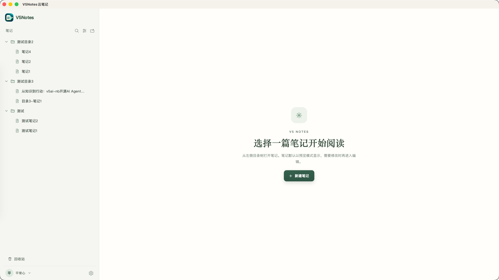
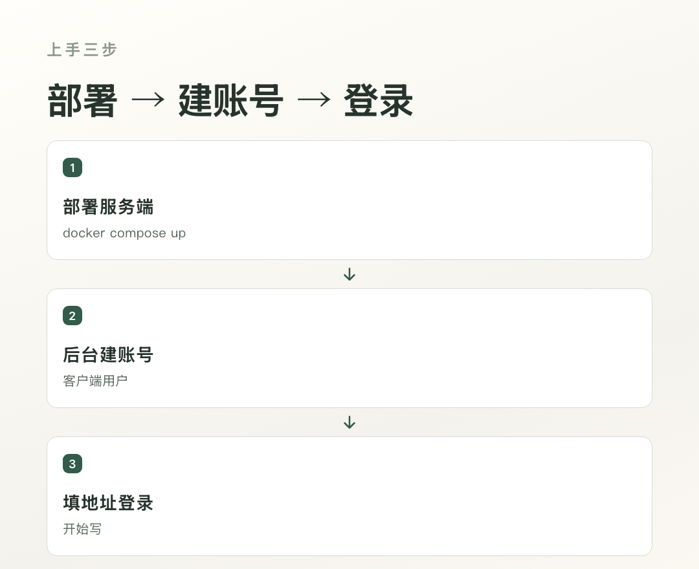
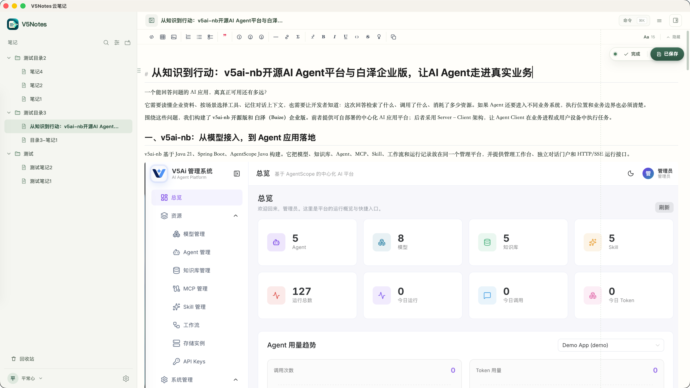

# 笔记存在谁家？我把三五年的笔记搬回了自己服务器

> 摘要：一套能私有部署的 Markdown 云笔记：三语界面、30 天回收站、历史版本，2.0.1 起有实时消息。

你有没有想过，写了三五年的笔记，其实一直存在别人的服务器上？

换台电脑、服务停掉、想整包导出，总有一刻会让人心里打个问号。

V5Notes 是我最近在用的一套开源 Markdown 云笔记：能装在自己的服务器上，桌面端照常写，换台电脑也能接着看。

## 一、一个很日常的小场景

在公司写了一半的笔记，回家打开另一台电脑，登录同一个服务器，目录和正文都还在——不用发文件、不用同步盘，也不用猜哪份是最新的。

家里有几个人想共用一个笔记库，就在管理后台各开一个账号，谁写谁的，互不打扰；2.0.1 之后，桌面端还能收到实时消息，忘了保存或被提醒，一眼就知道。 桌面端还会给未保存的改动做提醒，切换笔记前一定先问你保存、放弃还是取消。

## 二、三步就能用起来

第一步，用 Docker Compose 把整套服务拉起来：数据库、缓存、API、管理后台一次到位。

第二步，进管理后台建一个「客户端用户」账号。第三步，在桌面客户端填上服务器地址登录，就能开写。管理后台默认 8988 端口，API 默认 8080。

## 三、写作这块，它没偷懒

目录和笔记混在一棵树里，搜索、新建、重命名、删除都在一处；编辑器能在预览、编辑、源码之间来回切，撤销记录还留着。

正文支持表格、任务列表、公式和一百多种语言的代码块；右侧可以拉出大纲、全文查找，专注模式收起侧栏只剩正文。Ctrl/Cmd+S 保存，有改动切走前会先提醒你。 命令面板把常用操作收进一个入口，按 Ctrl/Cmd+K 就能唤起。

> 好的写作工具，是让你忘记工具本身。

## 四、数据在自己手里，才是最踏实的

笔记是一篇一份 Markdown，正文、目录、历史版本都在你自己的数据库里；附件也在自己的文件目录，备份时一起拷走就行。

删错了有 30 天回收站，改乱了能翻历史版本预览恢复。界面支持简体中文、繁体中文和英文，家里长辈也能用。登录用 RSA 加密，访问令牌只在内存，刷新令牌 30 天一次性轮换，密码不落地。 管理后台还能看到在线用户、登录日志和操作日志，系统正在发生什么，一屏就能查。

- 一篇一份 Markdown，随时整包带走
- 回收站 30 天 + 历史版本，改删都有退路
- 简体 / 繁体 / 英文，三语界面

## 五、它不做什么，适合谁

它不是多人实时协同工具：同一篇笔记两个人同时改，后保存的会覆盖先保存的，要靠历史版本找回。

它也不替你做运维，备份、证书、升级还得自己来。它适合愿意为一台服务器负责的个人、家庭和小团队——想要「笔记归自己」，又不想牺牲写作体验的人。 如果你的团队需要多人实时协作、或者完全不想自己管服务器，它未必是最优解；但只要你希望「笔记归自己」，它是一档很稳的选择。

一句话：把笔记搬回自己家，其实没有想象中麻烦。

---

**官网：**https://v5notes-website.v5ai.xin/
**项目地址：**https://github.com/zyw/v5notes
**Gitee：**https://gitee.com/zyw/v5notes

> 官网：v5notes-website.v5ai.xin ｜ 源码：github.com/zyw/v5notes ｜ 关注「自托管笔记」回复「笔记」领取部署与备份清单