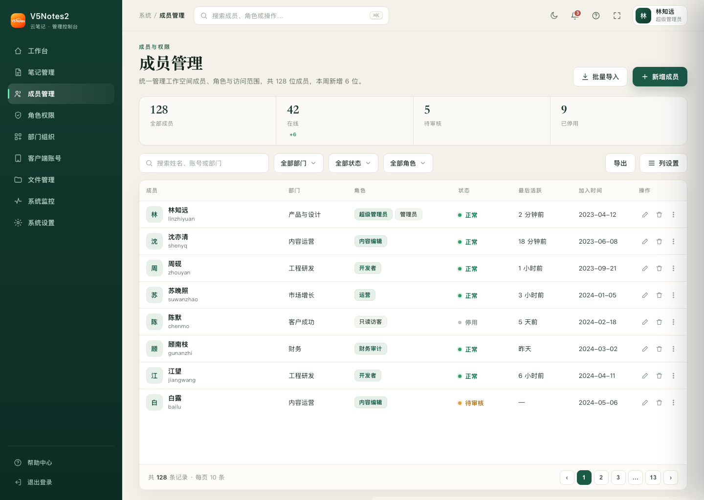
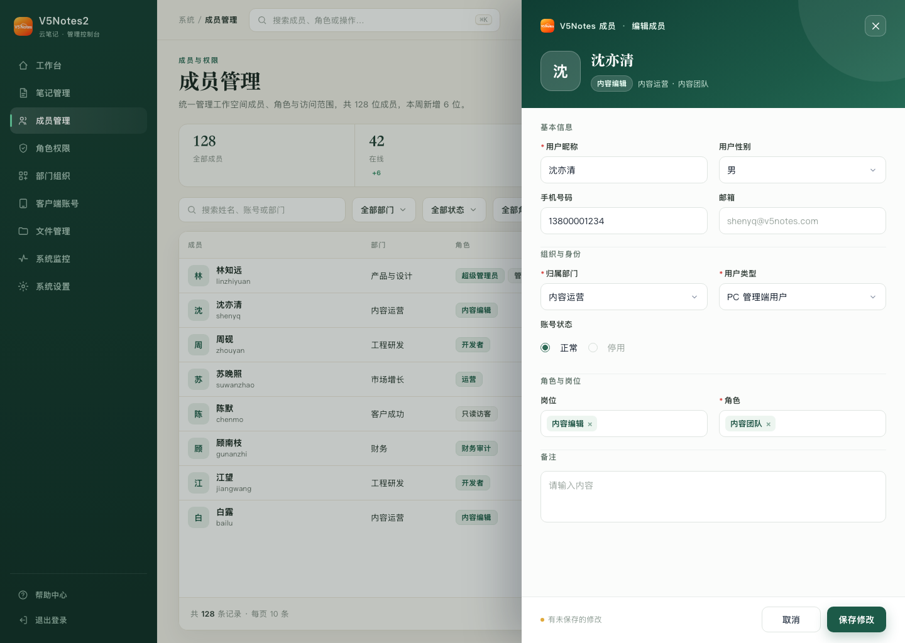
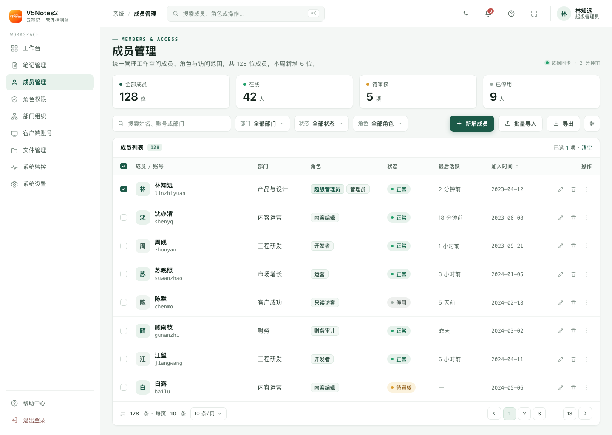
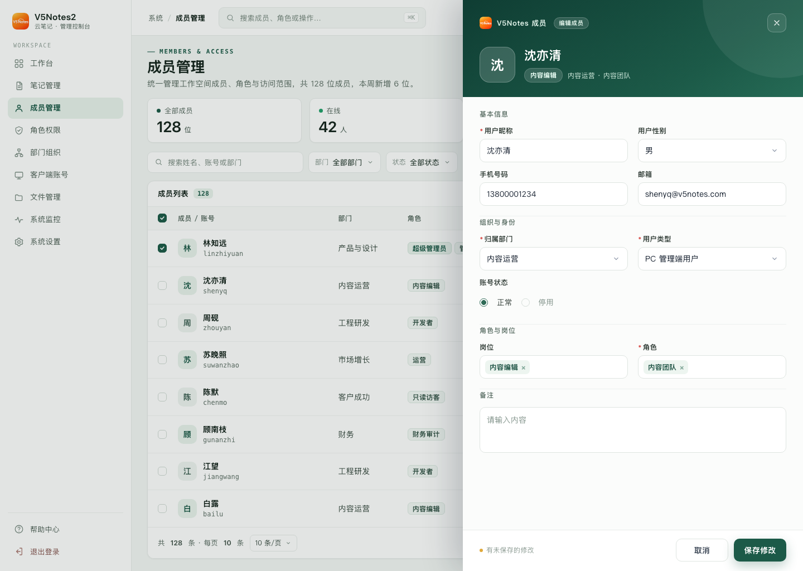
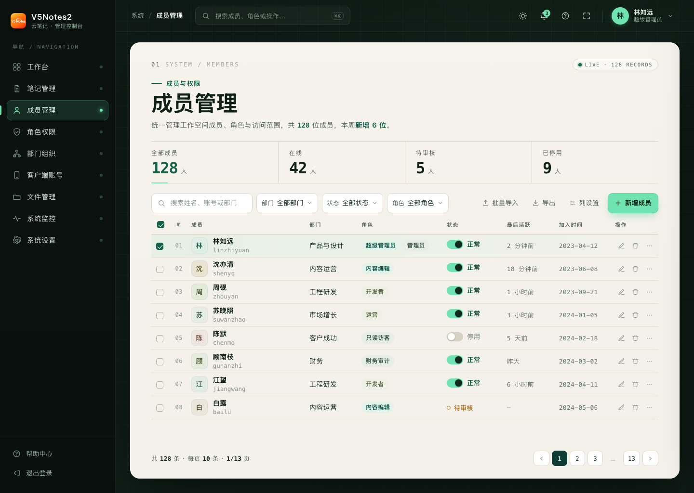
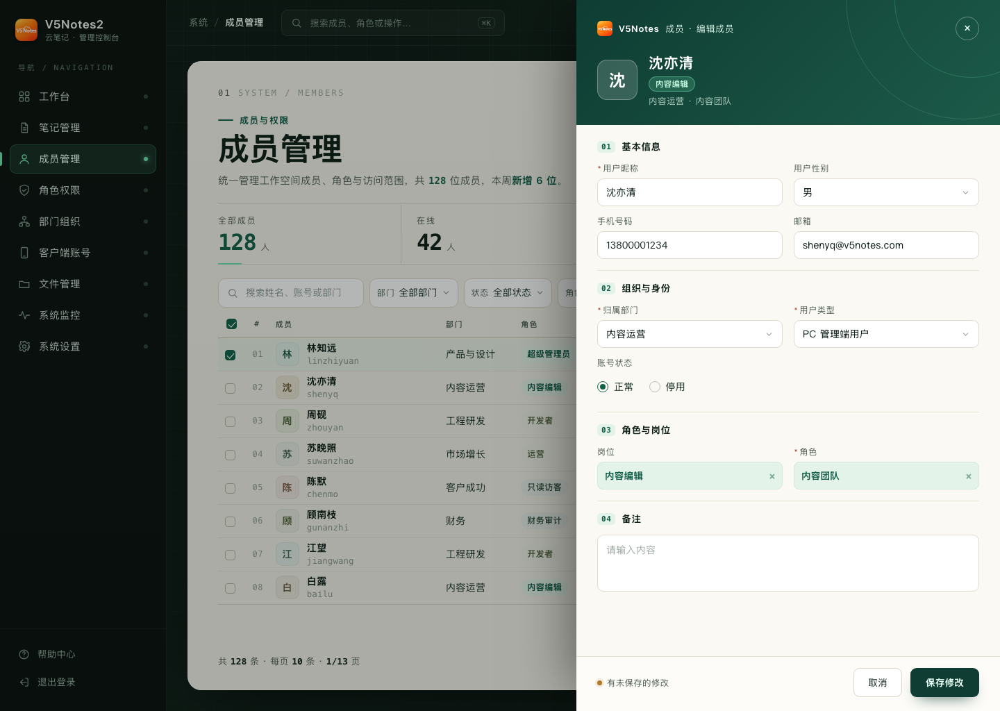

> ✅ **已选定：方向 2 · 薄荷工作台 Mint Workspace**（用户原话「方向 2 · 薄荷工作台 Mint Workspace ｜中性 · 清爽」，2026-11-06）。以下保留三方向记录与备选；落地规范见 `落地规范-方向2.md`。

# V5Notes2 管理端 · 整体风格与主题重设计 · 设计方案

> 目标：把用户已批准的「用户新增/编辑侧滑抽屉」（方向 C，2026-11-06，原话「确认走 C」）里的视觉 DNA，从单个抽屉扩展成**整个后台的统一主题**——侧栏、顶栏、页面头部、指标、筛选、数据表、分页、状态与控制、卡片、以及浅色/暗色两套令牌。
> 本方案先给 **3 个不同方向**完整稿（外加 3 个备选），请先选定方向，再进入主题令牌与组件落地。

---

## 一、从「已批准的抽屉」提炼出的主题基因

| 维度 | 取值 | 来源 |
|---|---|---|
| 品牌主色 | 墨绿 `#1c5a48`，深 `#0f3d33` → `#256a55` | 抽屉深绿身份头 |
| 底色 | 暖白卡面 `#ffffff` / 微暖纸内容区 `#fbfcfb` | 抽屉 body / foot |
| 边框 | 发丝线 `#e8ecea` / `#edf0ef` | 抽屉分区线 |
| 文字 | 标题近黑 `#111827`、正文 `#3f4a44`、次要 `#8a978f` | 抽屉标签与提示 |
| 强调点 | 琥珀 `#e0a93b`（未保存提示）、朱红 `#d9534f`（必填） | 抽屉提示/必填星 |
| 圆角 | 10–14px | 抽屉输入框 / 按钮 / 外壳 |
| 阴影 | 极克制，仅浮层与主按钮 | 抽屉主按钮 `0 8px 20px rgba(28,90,72,.28)` |
| 字体 | MiSans / HarmonyOS Sans SC / PingFang SC；可用 Noto Serif SC 作衬线标题 | 全站统一 |
| 语义映射 | primary→墨绿；success→苔绿；warning→琥珀；danger→砖红 | 替换现有 Element Plus 默认蓝 #409eff |

**这次改动的本质**：当前后台是「Element Plus 默认蓝 + 白」的通用皮肤；重设计要把上面这套**墨绿 × 暖白、克制、可长读**的语言变成全局默认，并同时提供对应的暗色态。

---

## 二、三个方向（同内容、同尺寸 1440×1024，只换设计与骨架）

每版都完整还原同一套内容（9 项菜单、顶栏、成员管理页、8 行真实数据、分页、右侧编辑抽屉），并都保留已批准的深绿抽屉头以保证「抽屉 + 外壳」是一套。

### 方向 1 · 深绿书斋 Forest Study（暖 · 安静）

- **逻辑与来源**：原研哉的留白与「素材即主角」× Vignelli 的严格网格；把抽屉的深绿身份头**升级为整条左侧导航**。
- **借的是什么**：全高深墨绿左栏（250px）+ 暖象牙画布 `#f4f1ea` + 纯白浮起卡面；页面标题用 **Noto Serif SC 衬线大字**；数据表用「发丝横线账册」而非竖边框；绿色只落在激活、主按钮、状态点；指标是一整条**分隔线统计带**（非卡片）。
- **骨架**：固定深绿左栏 + 暖象牙主区；页头「眉标 + 衬线大标题 + 副标题 + 右侧主操作」；统计带；账册表。
- **胆量花在哪**：整条深绿导航压在暖象牙画布上，一个动作定气质。
- **form 来自内容的哪里**：云笔记是「纸与文字」的生意，后台也该有书房/帐房的安静与可读，长时间看不累。

### 方向 2 · 薄荷工作台 Mint Workspace（中性 · 清爽）

- **逻辑与来源**：Linear / Notion 的浅色精密 SaaS 后台（同媒介真实参照）。
- **借的是什么**：`#f4f7f5` 画布 + 纯白卡；薄荷墨绿 `#1c5a48` 作**单点强调**（激活底 `#e8f2ec`）；浅色左栏；一行页头 + 4 个**扁平白指标卡**；高密度数据表 + 柔和三色 pill 状态（正常绿/停用灰/待审核琥珀）+ 等宽小类目标签；几乎不装饰。
- **骨架**：浅色左栏 + 顶栏 + 指标卡 + 工具栏 + 密集表 + 分页，信息密度最高。
- **胆量花在哪**：几乎不装饰，靠密度、对齐、克制阴影与微状态取胜。
- **form 来自内容的哪里**：后台是高频数据操作，清爽高效、扫读快就是它该有的样子——最贴近「拿来即用」的生产力工具。

### 方向 3 · 墨绿画屏 Grove Dark（大胆 · 深色）

- **逻辑与来源**：秒数轮盘·网页 #11「暗色双色侧栏开发者作品集 Dark Editorial」（Brittany Chiang）——深底 + 单一荧光 accent + 等宽编号。
- **借的是什么**：深墨绿近黑外壳（左栏 `#0b120f` / 画布 `#0e1a15` + 极淡网格）里**浮起一张暖白工作卡** `#f4f1ea`；单一荧光青绿 `#6fe3b0` 只落在激活、主按钮、关键数字下划线与开关；页头与表格行用**等宽编号**（`01 SYSTEM / MEMBERS`、行号 01–08）串起编辑气质；高对比但不刺眼、无蓝紫霓虹。
- **骨架**：深色左栏 + 深色画布 + 中央暖白工作卡；表格在卡内浅色区。
- **胆量花在哪**：整屏深色外壳 + 暖白卡，一个「画屏 / 暗房」姿态。
- **form 来自内容的哪里**：笔记与写作常在夜里发生，深色工作台是创作者真实的第二环境；也直接呼应产品现有的暗色主题能力。

---

## 三、三个备选（已在六宫格缩略图中，可随时做成完整版）

见 `thumbs.png`（六格总览）：
- **A2 · 暖纸账房**（吕敬人书籍设计 × 账册排印）：全暖纸浅色、无深色面、朱印一点、双线账册框。
- **B2 · 晨雾控制台**（Vercel/Resend 发丝线控制台）：冷白 + 单绿 + 等宽小标签 + 左侧二级筛选轨。
- **C2 · 竹影双栏**（秒数轮盘·东亚 #3 民国书衣）：暖纸 + 墨 + 朱红、竖排题签轨、双线外框、平涂几何。

> 另外三张是备选，看中哪张我可以做成完整版。

---

## 四、选定方向后的落地清单（主题层面）

1. **令牌**（`src/assets/styles/tokens`）：新增一套语义令牌 `--brand-*`（主色/深/浅/底/线条/文字/强调/圆角/阴影），并把 `--el-color-primary` 等 Element Plus 变量桥接到墨绿；同步出 `_theme-dark.scss` 的暗色对应（深色方向 C1 本身就是暗色样板）。
2. **外壳**：侧栏（`layout/Sidebar`）、顶栏（`Navbar/TopBar`）、TagsView、页面 shell（`components/_page-shell.scss`、`_card-shell.scss`、`_table-toolbar.scss`）统一套用新令牌与圆角/阴影语言。
3. **组件语言**：按钮（primary/ghost/danger）、输入与选择、数据表（表头、行高、hover、状态点）、分页、Tag/状态、指标带/卡、空状态、Toast。
4. **表单抽屉**：已批准的 `FormDrawer` 保持不变，仅让分区标题与按钮继承新令牌，确保「列表页 ↔ 抽屉」是一套。
5. **无障碍与底线**：正文 ≥14px、标签 ≥12px、正文对比度 ≥4.5:1；浅/暗两态都校核。

## 五、验证说明
- 三版均为**自包含单文件 HTML**（原生 HTML/CSS + 内联 SVG，无外部库；logo 用同目录 `logo.png`），1544×… 内完整呈现。
- 本机未安装 Python 版 playwright，`design_lint.py check/compare` 的浏览器体检自动跳过；三版差异已用**逐张截图肉眼对照**确认（骨架/气质明显不同：深绿左栏·暖纸 / 浅色·密度 / 深色外壳·暖白卡）。
- 两套截图：`dir-N.png`（默认态）、`dir-N-drawer.png`（打开编辑抽屉态，URL 加 `#drawer`）。

## 六、建议
- 追求「有产品温度、可长读、最不折腾」→ **方向 1 深绿书斋**；
- 追求「与现有团队习惯最接近、上线风险最低、效率最高」→ **方向 2 薄荷工作台**；
- 追求「品牌记忆点强、有暗色主题卖点」→ **方向 3 墨绿画屏**。
- 三版可混搭（例如「方向 2 的布局 + 方向 1 的深绿左栏」，或「方向 3 的深色外壳 + 方向 2 的密度」），告诉我你混哪两栏即可。
