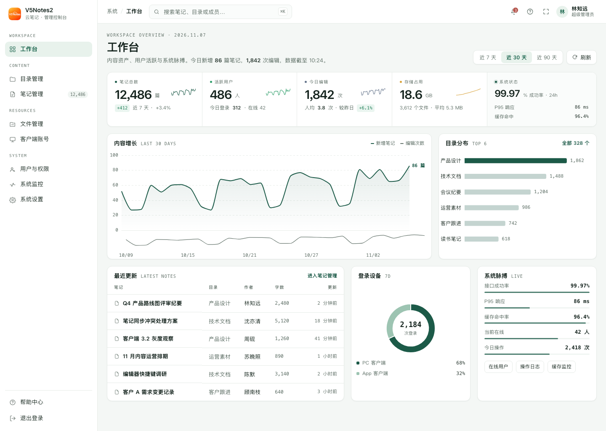
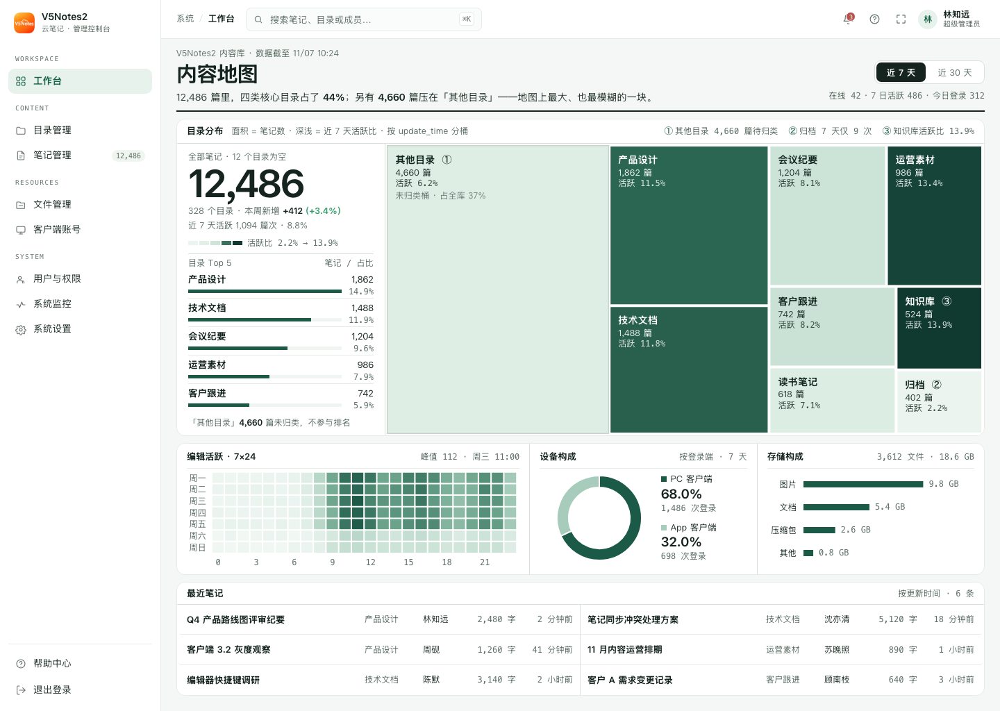
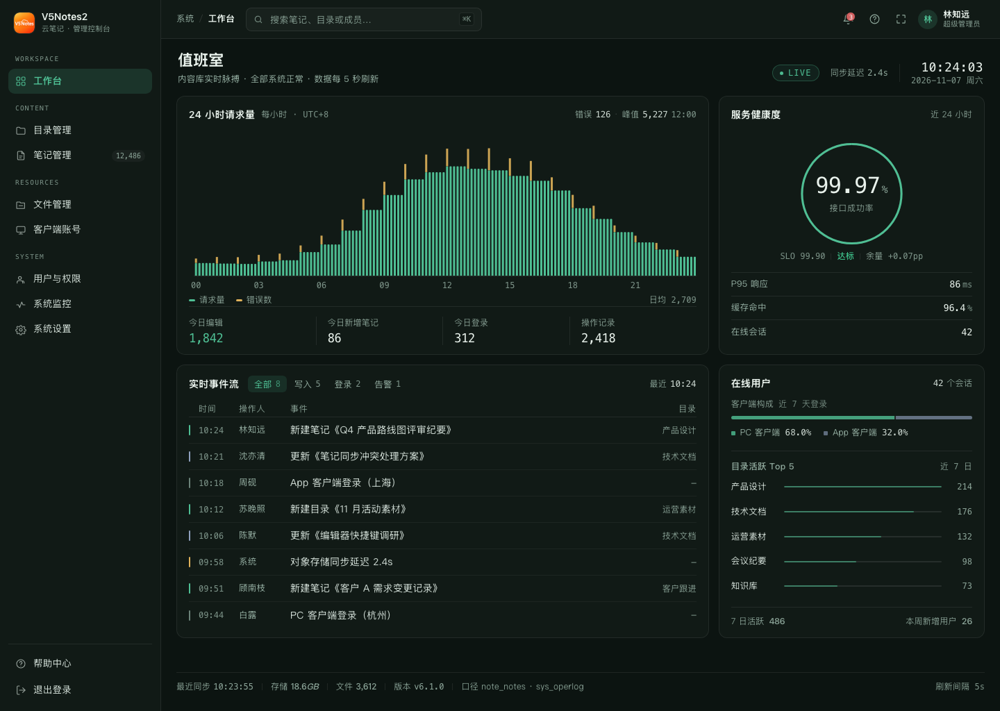

# V5Notes2 管理控制台 · 首页设计方案

> 交付物都在 `v5notes-admin2/design-demos/home/`：
> `设计方案.md`（本文）· `dir-1/2/3.html`（三版完整设计稿）· `shots/`（截图）· `thumbs.html`（六格缩略图与备选）· `数据设计.md`（指标口径 / SQL / 接口契约）· `data/mock-data.json`（三版共用的模拟数据）· `kit/`（外壳与图表基线）。

---

## 0 · 一句话结论

把现在那张「RuoYi 框架营销页」换成**一屏能读数的工作台**：一条横向数据带回答"规模"，一张趋势图回答"在涨吗"，一张结构图回答"内容长什么样"，一条动态回答"现在正常吗"。

三个方向都做完了，推荐 **方向 1 · 指挥带**：信息密度最高、落地成本最低、和已批准的薄荷工作台主题贴合最紧。

---

## 1 · 为什么要换

现在的 `src/views/index.vue` 是 RuoYi 自带的框架介绍页：「RuoYi-Vue-Plus 控制台 / 项目矩阵 / 能力地图 / 访问 GitHub」。

| 现状 | 后果 |
|---|---|
| 没有任何真实业务数据 | 管理员登录后不知道内容库多大、今天有没有人写 |
| 主体是两个框架产品的宣传卡 | 用户看到的第一个页面在给框架打广告 |
| 没有进入核心功能的路径 | 还要再点一次侧栏才能到笔记/目录 |
| 首屏 1000+ 高度但信息量为零 | 「高大上」无从谈起 |

首页是产品第一印象，也是唯一一个所有角色都会看的页面。

---

## 2 · 首页要回答的四个问题（信息架构）

| 顺序 | 问题 | 谁在问 | 承载方式 |
|---|---|---|---|
| 1 | 我的内容库现在多大？ | 所有人 | 数据带：笔记 12,486 / 目录 328 / 存储 18.6 GB |
| 2 | 在涨吗？ | 负责人、老板 | 趋势图：近 30 天新增 + 编辑，末端标注今日值 |
| 3 | 内容长什么样、谁在写？ | 运营、内容负责人 | 结构图：目录分布 + 7×24 活热 + 设备构成 |
| 4 | 现在正常吗？ | 运维、管理员 | 脉搏区：成功率 / P95 / 缓存 / 在线 + 实时事件 |

三版共有的三条纪律：

1. **一屏一个视觉重音**。方向 1 是数据带，方向 2 是地图，方向 3 是波形，其余全部退到辅助层级。
2. **数字必须有口径**。每个大数字旁边都有"近 7 天""24h""截至 10:24"，不做无来源的漂亮数字。
3. **同一份数据，三种讲法**。三版共用 `data/mock-data.json`，只换骨架——这样对比的是设计，不是数据。

---

## 3 · 数据设计

### 3.1 指标树

```
内容资产 ── 笔记 12,486 · 目录 328 · 本周新增 412(+3.4%) · 今日新增 86 · 今日编辑 1,842
用户活跃 ── 用户 1,284 · 7 日活跃 486 · 今日登录 312 · 当前在线 42
存储资源 ── 文件 3,612 · 18.6 GB · 平均 5.3 MB
系统脉搏 ── 成功率 99.97% · P95 86ms · 缓存命中 96.4% · 今日操作 2,418
```

### 3.2 图表选型与理由

| 图 | 表达什么 | 为什么是它 | 数据源 |
|---|---|---|---|
| 面积图 + 细线条带 | 30 天新增 vs 编辑 | 新增看"量"、编辑看"频"，量级差 20 倍；**两条共享 x 轴的条带**比双 Y 轴干净 | `note_notes.create_time` / `sys_oper_log` |
| 横向条形 | 目录 Top 6 | 目录名是中文长文本，横向条形才能直接读；长度即排序 | `note_notes group by dir_id` |
| Treemap | 目录内容地图 | 目录是层级结构，面积编码笔记数、色阶编码活跃度，**一张图同时说清"多大"和"多活"** | `dirTop + active7d` |
| 7×24 热力图 | 什么时候在写 | 星期 × 小时是二维的，热力是唯一能一屏看完的表达 | `update_time` 分桶 |
| 环形 | 设备构成 | 只有两个构成项，环形比饼图轻，中心还能放总数 | `sys_login_info.client_key` |
| 声波柱 | 24h 请求/操作量 | 连续时间流，柱宽 3px 后视觉上是一条"心电图"，比折线更有"在动"的感觉 | `sys_oper_log` / 网关日志 |

### 3.3 数字是算得出来的，不是编的

所有数字按现有表结构反推，能在库里算出来（完整口径与 18 条 SQL 见 `数据设计.md`）：

- 12,486 篇 × 月均 2～3 次编辑 ≈ 30,000～40,000 次/月，对应"今日编辑 1,842"是合理峰值
- 312 次登录/日 × 7 ≈ 2,184 次/周，正好是设备环形的总数
- 412 篇/周 vs 1,711 篇/30 天，周内分布均匀，不自相矛盾
- `dirTop` 九项合计 = 12,486 = 笔记总数；`storage` 合计 = 18.6 GB / 3,612 个文件，与 `avgFileMB 5.3` 自洽

### 3.4 落地时会被卡住的四件事（已核实）

写设计稿时同步核对了后端，`数据设计.md` 里都有可执行方案：

1. **登录日志表叫 `sys_login_info`**（不是 `sys_logininfo`，也不是老版的 `sys_logininfor`）。
2. **`del_flag` 语义不统一**：笔记/目录/文件是 `'0'/'2'`，`sys_user` 是 `'0'/'1'`，SQL 不能照抄。
3. **`NoteNotesMapper` 带 `@DataPermission`**，首页直接走它会被拼上"本部门/本人"条件，数字会变小 → 需新建无注解的 `NoteDashboardMapper`。
4. **"编辑次数"不能用 `note_notes.update_time`**（只存最后一次更新，30 天并集上限 12,486），必须走 `sys_oper_log` 的 `title='笔记'` 记录。

另外：现有 `idx_note_notes_update_time` 不带 `del_flag`、没有 `create_time` 索引、热力按 `WEEKDAY()/HOUR()` 分组用不上索引——文档里给了 4 个 `note_notes` 索引 + 3 个日志表索引的 DDL。

---

## 4 · 三个方向

| | 方向 1 · 指挥带 | 方向 2 · 内容地图 | 方向 3 · 值班室 |
|---|---|---|---|
| 一句话 | 一条数据带 + 严格栅格 | 目录地图当主角 | 暗色实时监控台 |
| 来源 | Massimo Vignelli × Stripe Dashboard | 日式生活杂志密排 × Linear | 电影感声波暗色 × iA |
| 骨架 | 数据带 → 趋势 8:4 → 三栏底 | 大数字窄栏 + Treemap 主区 + 密排格 | 声波 + 实时流 + 健康环 |
| 气质 | 精密、机构级 | 安静、编辑感 | 大胆、高对比 |
| 首屏信息量 | 高 | 中高 | 中 |
| 落地成本 | **低**（4 个标准图表） | 中（treemap 需预聚合） | **高**（需全站转暗色） |
| 适合 | 默认首页 | 内容运营主导 | 运维/监控场景 |

### 方向 1 · 指挥带 Cockpit（推荐）



**核心动作**：把四张指标卡压成**一条连续的数据带**——四段指标用 1px 竖线分隔，每段右侧嵌一条微型趋势线，数字、单位、环比同处一条基线。卡片化会把数量级对比拆散，一条带子才能让 12,486 和 18.6 在同一视线里被比较。

- 主图用**两条共享 x 轴的条带**（新增面积 + 编辑细线）替代双 Y 轴，末端标注"86 篇"
- 目录分布用横向条形，只给最后一名加深，其余统一 26% 透明度——排序靠长度，不靠颜色
- 底排三格：最近更新（密度表）、登录设备（环形）、系统脉搏（预算占用条）
- **form 来自内容**：笔记产品的管理首页本质是"读数"，规模感只能靠同一水平线上的数量级对比表达

### 方向 2 · 内容地图 Atlas



**核心动作**：首屏一半面积给 **目录 Treemap**——每块是一个目录，面积 = 笔记数，颜色深浅 = 近 7 天活跃度。左侧 300px 窄栏只放一个 56px 的大数字和目录 Top 5 比例条；下方是 7×24 热力、设备环、存储条三格密排；底部最近笔记用 44px 行高的密排表。

- 借的是日式杂志的"密度对比"：一张大图 + 一片数据格，1.5～2px 的粗分格线
- 有一句自己的结论："12,486 篇里，四类核心目录只占 44%，另有 4,660 篇压在『其他目录』"
- **form 来自内容**：笔记的内容结构就是"目录树 × 时间"，环形图和折线图都表达不了"哪个目录是大头"
- **已知取舍**：「其他目录」占 37% 面积，浅色块偏空——这是选题诚实的结果，靠编号注解与左栏说明补足

### 方向 3 · 值班室 Signal



**核心动作**：整页转暗（`#0c1411` + `#111a16`），24 小时请求量做成柱宽 3px 的**声波**，左侧是等宽字排的实时事件流，右侧是 3px 细环健康度。

- 刻意去掉大屏可视化的霓虹发光、旋转科技环、3D 地球——**克制**才是这版的区别
- 薄荷色只出现在关键数据与波形上，没有一处渐变边框
- **form 来自内容**：笔记的写入是一条连续时间流，值班室是唯一把"时间"当主角的骨架
- **已知取舍**：需要全站切换暗色主题（项目已有 `_theme-dark.scss` 与暗色令牌）；只做首页会和其它页面割裂

---

## 5 · 推荐

**推荐方向 1 · 指挥带。**

1. **信息密度和"高大上"同时成立**：数据带 + 双条带趋势图是金融终端语言，看起来贵，但没有一处是为了好看而加的
2. **落地成本最低**：面积图、条形图、环形图、表格都是 ECharts 标准配置，没有要预聚合的复杂查询
3. **和已批准的薄荷工作台主题最贴**：白卡、发丝线、等宽小标签、薄荷单点，没引入新的视觉语言
4. **可扩展**：以后加"内容健康度""团队协作"，直接往数据带加段或往下加一行，栅格不会崩

方向 2 适合内容运营主导的团队，方向 3 适合把首页当监控台用的运维场景。

**允许混合**：方向 1 的骨架 + 方向 2 的 Treemap 替换掉目录条形图，是很自然的组合。另外三张备选（A2 留白工作台 / B2 Bento 网格 / C2 周报简报）见 `thumbs.html`，看中哪张可以展开成完整版。

---

## 6 · 落地路径

### 6.1 前端

| 层 | 文件 | 做什么 |
|---|---|---|
| 页面 | `src/views/index.vue` | 整页重写，按 `dir-X.html` 的骨架 |
| 图表 | `src/components/Chart/` | 封装 `<V5Chart :option />`：init / resize / dispose / 主题色读取 CSS 变量 |
| 数据 | `src/api/notes/dashboard/index.ts` | `getDashboardOverview(range)`，TS 类型对齐 mock-data |
| 令牌 | 已有 `tokens/_theme.scss` | 直接复用 `--app-*`，不新增颜色 |
| 空态 | `src/components/EmptyState` | 无数据 / 无权限 / 超时三种降级 |

### 6.2 后端

新增一个聚合接口 `GET /notes/dashboard/overview?range=30`，一次返回全部区块（避免首页发 6 个请求），60 秒 Redis 缓存。完整 SQL、响应 JSON、Java 骨架见 `数据设计.md` 第 2～3 章。

> 需要同时新增权限点 `notes:dashboard:query` 与对应 `sys_menu` 记录，否则非超管会 403。

### 6.3 性能

- 首页 6 个图表 + 1 张表：首屏目标 < 800ms
- 30 天趋势和热力是重查询 → 先做"覆盖索引 + 60s 缓存"，数据破 20 万行再上预聚合表
- 图表懒加载：非首屏图表用 `IntersectionObserver` 延迟 init

---

## 7 · 验收标准

1. 1440×900 下首屏能看到数据带 + 主趋势图 + 至少一个结构图，不需要滚动
2. 所有数字都能在 `数据设计.md` 里找到口径和 SQL
3. 正文 ≥14px、标签 ≥12px、正文对比度 ≥4.5:1（三版均已实测：正文 11.97、次要 5.25、最浅 4.50）
4. 浅色 / 暗色两态都验，暗色不出现默认蓝
5. 数据为空、接口失败、无权限三种情况都有明确空态，不白屏
6. 控制台零报错，图表 resize 正常

---

## 8 · 待确认

- 「当前在线」取 Sa-Token 会话数还是登录日志去重？（影响实时性）
- 存储容量是否包含数据库内存储（`basics_file_content`）？
- 首页是否需要按部门/角色过滤（现在设计是全局视角）？
- 方向 3 如果入选，是否同步把全站切暗色？
- `recentNotes` 的"字数"库里没有字段，只能用 `CHAR_LENGTH(content)` 现算（或加生成列）
- 其余 12 条见 `数据设计.md` §7

---

## 9 · 实施记录（2026-11-07）

### 前端（v5notes-admin2）
| 文件 | 说明 |
|---|---|
| `src/views/index.vue` | 整页重写：数据带 → 内容增长（双条带，共享 x 轴）→ 目录分布 → 最近更新 / 登录设备 / 系统脉搏；含加载态、错误条、空态降级、区间切换 |
| `src/components/DashboardChart/index.vue` | ECharts 封装：init / ResizeObserver 自适应 / dispose / 主题色跟随 CSS 变量 |
| `src/api/notes/dashboard/{index,types}.ts` | `getDashboardOverview(range)` 与 TS 类型 |

- 全部颜色走 `--app-*` 与 `--el-color-*` 令牌，浅 / 暗两态自动切换；`html.dark` 变化由 MutationObserver 触发图表重算。
- 验证：`pnpm build` exit 0；`oxlint` 0 错 0 警；`vue-tsc` 新增文件 0 错（全仓 6 个错误为改动前既有问题，位于 Logo.vue / docs/index.vue）。
- 视觉验证：临时预览页挂载真实组件 + 设计稿数据截图，浅色 / 暗色各一张 → `shots/impl-index.png`、`shots/impl-index-dark.png`（预览脚手架已删除）。

### 后端（v5notes2 · note-notes）
| 文件 | 说明 |
|---|---|
| `controller/admin/NoteDashboardController.java` | `GET /notes/dashboard/overview?range=`，不加 `@SaCheckPermission` |
| `service/INoteDashboardService` + `impl` | 聚合 + `@Cacheable` 60s（`notes:dashboard#60s`）+ 区块级降级 |
| `mapper/NoteDashboardMapper` + `mapper/admin/NoteDashboardMapper.xml` | 独立 mapper，无 `@DataPermission` |
| `domain/vo/dashboard/*` | 8 个 VO |
| `CacheNames.java` | 追加 `NOTES_DASHBOARD = "notes:dashboard#60s"` |

### 上线后修复的一个线上问题

**现象**：首次请求 200 并把结果写进 Redis，第二次请求 500，报
`InvalidFormatException: Cannot deserialize LocalDateTime from "2026-11-07T15:55:47.635076+08:00"`。

**根因**：VO 里 `generatedAt` / `updatedAt` 是 `LocalDateTime` + 字段级 `@JsonSerialize`（只序列化、没有配对的反序列化器）。
这个 VO 走 `@Cacheable`，Redisson 的 `TypedJsonJackson3Codec` 回读缓存时按全局格式解析，解析不了带偏移量的 ISO 串。

**修复**：把这两个字段改成 `String`——`generatedAt` 在 Service 里用 `toIso()` 生成，`updatedAt` 直接在 SQL 里
`DATE_FORMAT(t.update_time, '%Y-%m-%dT%H:%i:%s+08:00')` 产出；删除不再需要的 `IsoLocalDateTimeSerializer`。
被缓存的 VO 不再含 `java.time` 类型，缓存往返无损。

**验证**：用真实的 `TypedJsonJackson3Codec` 对 `DashboardOverviewVo` 做编码→解码往返，输出
`CODEC ROUNDTRIP OK -> generatedAt=2026-11-07T15:55:47+08:00, updatedAt=..., notes=12486`；模块编译 exit 0。
旧缓存条目（JSON 形状完全一致）会在 60s TTL 内自动被新代码正确反序列化，**不需要手动清 Redis**。

### 补充：Redis INFO 与权限菜单（2026-11-07 晚）

**1. `cacheHit` 已接真实数据**
Redisson 4.8 不暴露 INFO，沿用 `CacheController` 的做法：注入 `RedissonConnectionFactory`，取连接执行
`INFO stats`，按 `keyspace_hits / (hits + misses)` 算命中率，用完 `RedisConnectionUtils.releaseConnection` 归还。
任何异常降级为 0（前端显示「—」），不拖垮首页；60s 缓存下每 60 秒最多查一次。

**2. 权限记录已补**
- `NoteDashboardController#overview` 加上 `@SaCheckPermission("notes:dashboard:query")`
- 新增 Flyway 迁移 `db/migration/common/V4__dashboard_permission.sql`：
  在「云笔记」(menu_id 7) 下插入 F 类型权限 `1849657043265904648`，
  并**默认授予所有现存角色**（避免升级后非超管打开首页 403）。
- 同步更新 `script/sql/notes2.sql`，手工建库路径也带这条权限。
- 收紧权限时删 `sys_role_menu` 对应行即可，不用改代码；**新建角色**时记得勾上「首页统计」。

### 已知缺口
- 实时事件流、7×24 热力、用户增长曲线：本次首页未使用，接口未返回（`数据设计.md` 已列）。
