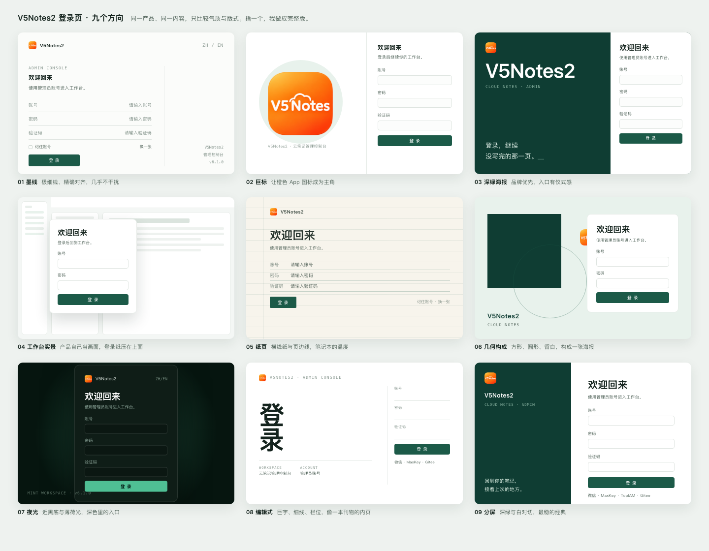

# 登录页 · 第五轮（九个方向风格板）

前三轮被否（「都不是很理想」「都不是我想要的」），不再盲做完整版。先出九个**气质不同**的方向各一屏缩略，选一个再做完整稿。

| # | 方向 | 一句话 |
|---|---|---|
| 01 | 墨线 | 极细线、精确对齐，几乎不干扰 |
| 02 | 巨标 | 橙色 App 图标成为画面主角 |
| 03 | 深绿海报 | 品牌优先，入口有仪式感 |
| 04 | 工作台实景 | 产品自己当画面，登录纸压在上面 |
| 05 | 纸页 | 横线纸与页边线，笔记本的温度 |
| 06 | 几何构成 | 方形、圆形、留白，构成一张海报 |
| 07 | 夜光 | 近黑底与薄荷光，深色里的入口 |
| 08 | 编辑式 | 巨字、细线、栏位，像刊物内页 |
| 09 | 分屏 | 深绿与白对切，最稳的经典 |

打开 `board.html` 可看原大（1440×1120）；选定编号后，按 1440×900 + 375×812 做完整稿并补交互。
